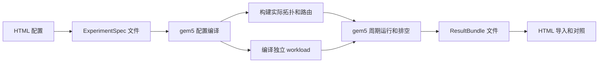

# PCIe 6.0 Switch 仿真实施计划

版本：v1.1｜日期：2026-11-20｜状态：M0–M4A 已通过本地阶段验收。
依据[需求](PCIe6_Switch_Requirements.md)、
[硬件架构](PCIe6_Switch_Architecture.md)与
[仿真架构](PCIe6_Simulation_Architecture.md)。本文件是阶段依赖、任务与
完成证据的唯一计划；不承诺未经估算的日历工期或已运行结果。

## 1. 交付边界与依赖

TDD是下述每个任务的开发方法，不替换M0–M5的功能交付顺序或gem5
Switch实现设计。每项任务在实现前先构造可执行验证场景、独立expected/
checker与退出标准；记录语义Red、最小Green与回归，再重构。
不采用函数→SystemC→RTL降低路线。新增
[验证场景目录](PCIe6_Validation_Scenarios.md)只补充测试合同。

先完成HTML功能合同与参考对照，再实现gem5有限资源模型，然后完善
详细Gen6、页面/workload集成和可选controller/产品扩展。

M0–M2 已提供 63 字段输入、参考 sizing/CLI/bench、单颗/级联
有限资源 fixture 与结果；M3 进一步交付详细 FLIT 子集。
M4 先交付可独立运行的 gem5/HTML 闭环（M4A），再接入 SimAI
（M4B）。M4B 实现和联调以 M4A 验收为前置，M4A 继承 M3
验收的周期数据面。M5 各扩展按各自合同验收。

| 阶段 | 当前状态 | 退出门 | 需求映射 |
|---|---|---|---|
| M0 | 本地验收完成 | 63字段/结构/来源合同与21项测试通过；记录见validation/M0.md | F-01/04/08/09，T-01 |
| M1 | 已验收 | sizing与JSON对照、S-01–S-07参考回归 | F-02/07/19/20/21，T-02/03 |
| M2 | 已验收 | 有限单颗/级联、数据/资源守恒、S-08排空 | F-03/06/17/22，A-01至A-04/07，T-04 |
| M3 | 完成 | 所选Gen6条款和周期门通过；固定profile的性能目标按用例分别判定 | F-01/02/06/19，T-05 |
| M4A | 已验收 | HTML 配置驱动 gem5 实际建拓扑并独立运行 workload，结果可导回 HTML，与旧格式兼容 | B-02/03/04/05，F-03/04/09/19/20/21，T-06 前置 |
| M4B | 待实现 | 同一 gem5 构建器和 runtime 接入 SimAI，完成 collective/DAG 闭环与旧 backend 回归 | B-01/06，F-22，SIM-02–16，T-06 |
| M5 | 未开始 | 按extension逐项满足入口与测试合同 | F-05/10至F-16/18/23至F-32，T-07至T-10 |

## 2. M0：规范、schema与能力合同

前置：Base Spec 6.0、HTML和需求可访问。databook为补充，目前不在工作区；
不阻塞基础阶段，但M5接口细化前须恢复可核对版本。历史竞品链接不视为
当前有效证据；涉及冻结时重新核查。

| 任务 | 产物（计划路径） | 完成证据 |
|---|---|---|
| M0-01 | `util/pcie_lab/`字段manifest/schema | 与HTML hardwareFields逐项一一对应，共63项；默认/范围/条件/单位一致 |
| M0-02 | 同目录protocol capability表与条款测试索引 | 请求/Completion/RCB/Tag/ordering/VC/FC/FLIT的规则、近似和不支持项明确 |
| M0-03 | ExperimentSpec/ResultBundle及metadata schema | raw/effective、mode/fidelity/profile、seed/hash/version、窗口和单位明确 |
| M0-04 | topology/resource/profile schema | HTML slices与物理Slice分开；端点角色/Shared FC补参有来源；未知项不静默忽略 |
| M0-05 | 固定HTML/Base Spec来源hash与参考提取说明 | oracle可重复提取，不复制PDF正文/图/RTL；记录同Tick排序和舍入策略 |

退出：字段覆盖100%；边界与非法配置案例可审查；RCB=64B的参考含义和
严格端点角色约束分开；任何缺省严格参数有显式默认及理由或明确拒绝。
此阶段不要求新增仿真功能，也不以文档完成声称协议实现完成。

## 3. M1：参考sizing、事件与JSON对照

前置：M0合同固定；新增源文件版权持有人明确。

| 任务 | 产物（计划） | 验收 |
|---|---|---|
| M1-01 | 纯解析sizing工具 | 分段、字节/Cell、RTT、Tag、限制项排序及全部资源输出与页面一致 |
| M1-02 | 自动资源解析与诊断 | 全部0=自动、32-bit取整、2次幂及H/D非2次幂规则；显式值不被覆盖 |
| M1-03 | legacy JSON导入/结果导出adapter | hardware-calibration全字段/null保持；workspace另识别；未知版本明确拒绝 |
| M1-04 | gem5参考事件组件与运行配置 | 参考FC回收、replay限速、FIFO、时长截短、20%预热和样本口径可复现 |
| M1-05 | `tests/gem5/pcie/`参考golden/回归 | S-01–S-07按HTML真实diff执行，结果绑定source hash/输入 |

解析整数项和字段必须精确匹配；浮点比较事先声明绝对/相对容差，不能
观察到差异后任意放宽。事件结果按同一窗口/同Tick规则比较，额外保存
首个分歧事件和误差来源；未经对照不能声称参考复现。

2026-11-18进度：M1-01/02 已通过解析 sizing 对照。先将锁定 HTML
的 15 组输入与 `sizeHardware` 完整结果保存为 fixture，空实现对照全部
失败（Red）。Python 计算实现后，字段、列表顺序、整数和诊断精确匹配，
小数按相对误差 `1e-12`、绝对误差 `1e-10` 对照（Green）。
`--size` 的 CLI 回归覆盖显式资源、自动零值、无界上限及严格模式拒绝。
M1-03 的导入和导出使用页面真实导出字段作对照，覆盖未运行的 Read/
Write 和带浏览器仿真结果的 Read。先运行 CLI 测试得到 8 个失败子例
（Red），实现后相同子例通过（Green）。导入用 `inputs` 和可选 seed 创建实验，
完整旧快照保留在 `imported_calibration`。重新导出已导入文件保留全部
字段和空值。新导出附带版本化来源和单位，`sim` 为 `null`。

S-01/02/03覆盖64B/4KiB/MRRS512；S-04/05/06覆盖32 Tag、H=1、256-bit
端口；S-07的1-cell出口预期容量检查失败，是成功捕获不足，不是模型
通过有限容量验收。五个preset与七个bench区分保存。

S-01–S-07 已从锁定 HTML 提取实际 bench diff、完整输入及事件结果。
使用 `node tests/pcie_switch/fixtures/generate_reference_events.js`
重放，生成 `tests/pcie_switch/fixtures/reference_events.json`。生成器
核对页面原判据。S-02/03 的吞吐判据通过，同时 `queuePass=false`，
gem5 对照保留两项观测。M1-04 参考运行入口与 M1-05 TestLib 对照
已在当前分支通过 14 项检查。详见 [M1验收记录](validation/M1.md)。

参考事件执行以 gem5 主事件队列推进，每次回调的 tick 对模型的浮点 ns
截止时间向上取整到 ps。兼容调度层按 HTML heap 保留相同时间事件的
处理次序，参考窗口、吞吐和延迟仍按页面浮点时间统计。测试要求计数、
状态和配置完全一致，小数使用与 sizing 相同的预设容差。该行为只用于
`lab_reference`，硬件周期模型采用自身资源事件和周期测点。

退出：输入/输出契约、sizing回归和S-01–S-07通过；导出可重新导入相同
配置；HTML保持离线能力。尚无gem5有限队列正确性的承诺。

## 4. M2：gem5有限资源单颗与级联

前置：M1提供输入和对照，M0明确TLP子集与所需扩展参数。

| 任务 | 产物（计划） | 验收 |
|---|---|---|
| M2-01 | transaction、Requester/Completer、测试sink | MPS/MRRS/4KiB/RCB、Tag与Cpl预留；数据内容/长度正确，完成一次 |
| M2-02 | 双向Link、RX backing与资源事件 | 逐跳服务/传播、有限credit窗口、实际释放更新；无无条件定时回收 |
| M2-03 | core allocator/VOQ/order engine | 原子分配、保留池、eligible关系与守恒；小事务descriptor瓶颈可观察 |
| M2-04 | scheduler/Fabric/staging | 并行通道服务、出口争用、同/跨区路径；联合grant无部分长期持有 |
| M2-05 | Packet adapter、retry、drain | 请求/响应重试不双提交；源可复用与目的可见分开；drain后数据正确 |
| M2-06 | 单颗/两颗级联configs与TestLib | request/Completion路径、慢出口反压上溯、停发后排空 |
| M2-07 | metrics/trace与差异报告 | 资源峰值、stall、事务/应用时间戳、未完成/超时；解释与参考结果差异 |

M2-01 的首批 DW 对齐 TLP 用例先用空桩取得八个语义 Red。
`pcie_request.test` 的单元实现覆盖请求分段、Completer 分段和
Requester 重组、分 Function Tag 额度及 Completion 缓冲预留。
原生端点与 Link 已接入带多个 Requester 和一个目标地址窗口的
透明链式运行时。

M2-02/03 已增加独立的 Link、core admission 和 ordering 单元实现。
逐方向 Link 按 VC/类别跟踪可用、在途、RX 占用和返回在途的 H/D，
释放事件后到达发送端的更新才可再次消耗。核心 ledger 每入口原子
持有 descriptor、payload sector 和活动 VOQ 索引，并保护 P/Cpl
预留。Ordering 模型按入口/partition/TC 及 Completion 身份维护依赖。
M2-04 将这些组件接入 C++ SwitchCore，RX 到 core 写入完成后才
归还 RX 信用；仲裁在同一次授权内占用 read bank、Fabric 通道和出口暂存。
测试连接实际 Link、SwitchCore 与 EndpointMemory，在有限输出
信用阻塞时观测反压上溯，恢复后核对完整 payload 并排空。
M2-05/06 的 `PcieTiming` 在 gem5 主队列运行单颗和两颗拓扑。
Packet 拒绝时保留发送者所有权，已接管 Posted Write 的源响应与
后续目的内存提交分别记录。Native driver 检查双向 retry、跨页数据
和在途 drain。S-08 覆盖原生 8→1、目标暂停、一格暂存对照、64 B
和 4 KiB 及受限内部资源。详见 [M2验收记录](validation/M2.md)。

最小实验集：单Read/Write、双向、64B与4KiB、8→1、steady/burst、
小Tag/credit/descriptor/pool/egress、端口/Fabric瓶颈和级联返回路径。
严格模式缩小egress必须造成反压，不复现参考模式“超限后继续入队”。

退出：S-08全部通过；字节/Tag/credit/sector/descriptor/引用守恒；无
双释放/静默drop/重复回调，必要的ordering越过可前进且可排空。超时必须
带等待图/在途快照；watchdog只检测问题，不能当作死锁修复或通过证据。

M2无错TLP预算下的ACK/replay空间若采用近似须标记；不得提前声明M3。

## 5. M3：详细Gen6与目标性能评估

前置：M2有限资源正确，协议条款预期结果独立于被测实现。

| 任务 | 产物（计划） | 验收 |
|---|---|---|
| M3-01 | 合法FLIT header/OHC、packing/flush、跨FLIT组装 | 256B布局、TLP边界/填充、小包混合和部分FLIT的expected traces |
| M3-02 | dedicated/shared FC及能力/更新状态 | TX必需能力、RX可选配置、VC计数/usage限制、信用回收与计数边界 |
| M3-03 | ACK/NAK/timeout/replay与注错 | 副本容量、DLP更新、重发服务、重复抑制、恢复/排空与资源守恒 |
| M3-04 | ordering/Completion规则覆盖 | 合法/非法越过、分段/错误Completion、能力不匹配的条款测试 |
| M3-05 | 参数敏感性/competitor_target评估 | 吞吐/短包/置换/尾延与测点明确，目标结果有输入与误差边界 |
| M3-06 | 周期级profile和资源服务验收 | V-35：端口TLP/cycle、bank/RAM读写、仲裁/Fabric/staging、时钟/CDC和释放边沿有独立周期trace；通过后进入 M4A |

M3-01–04 覆盖所选 Memory TLP、FLIT packing 和 CRC、已初始化
的 Shared/Dedicated FC、Standard Replay 及 Completion/ordering
规则。原生回归含合并共享、专用回退、配对反向 ACK/NAK、故障
恢复、两级 8→1 一格暂存和不支持的 TX 能力诊断。M3-06 以
独立时序覆盖 parser、bank/Fabric 逐拍服务、两端 CDC、staging
和真实物理发出边界。M3-05 已运行 SW-LAT、RTT-64、SW-BULK、
SW-SMALL、SW-PERM 和 SW-TAIL；部分 Read 吞吐目标未达标，
缺 PHY/端点标定的目标保持不可比。配置、测点、能力限制和复现
入口详见 [M3验收记录](validation/M3.md)。

退出：只对覆盖矩阵中已实现条款声明通过；非实现项保持缺能力。FEC以
可控错误/延迟抽象时明确不含模拟信道/电气行为。Gen5/non-FLIT兼容须另
建profile和测试，不由低速FLIT配置自动获得。

C/T在定义安全转发与错误提交条件后单独实现/验收，再评估COMP-04。
不能把90ns或250ns填成固定阶段时延后称为目标闭合。

## 6. M4：独立 gem5 闭环，然后接入 SimAI

### 6.1 M4A：HTML 配置、gem5 建拓扑与独立 workload、结果回导

前置：M1 格式合同、M2 有限资源、M3 周期和所选协议验收。
M4A 的 `compile_cycle` 与 `configs/example/pcie/cycle.py` 将
配置中拓扑及链路/端口资源应用到实际运行的 gem5 对象。

HTML 保持离线，用户导出带版本的 `ExperimentSpec`，包括硬件
profile、拓扑及端点放置、测量窗口和独立 workload。gem5 CLI
校验并规范化为 `TopologyIR` / `WorkloadIR`，由构建器创建
Requester/Completer、Switch 及双向 Link；用同一事件队列执行，
排空后生成 `ResultBundle`。用户将结果导回 HTML，与绑定原快照
的参考结果或另一模型结果比较。

交付的拓扑样例包括单交换机 star、有两颗 Switch 的级联和可验证的
透明分支。编译器把节点、port/lane、链路双向参数、Requester ID、
地址窗口和路由显式绑定；记录每个配置 ID 对应的实例和逐 flow 路径。
对 split/direct 和通用 graph 输入按能力检查；只有可映射到已支持
物理转发合同的配置可运行。未知路径、环、超预算、窗口冲突和未支持
的跨域配置在启动流量前诊断。

| 任务 | 产物（计划） | 独立验收 |
|---|---|---|
| M4-03 | ExperimentSpec→TopologyIR / WorkloadIR / FlowIR 与 placement 编译 | node/port/link/地址及依赖合法性、单位、稳定 ID 和有效参数可审计；V-36/37 |
| M4-12 | gem5 拓扑构建器、独立 CLI 和 runtime facade | 从配置创建并连接真实对象，输出生效拓扑；变更链宽/资源或级联数改变对应路径/计数；V-36 |
| M4-04 | 独立 P2P、incast、显式 collective 流及小型通信 DAG | 配置给出 release、Read/Write、字节与依赖，实际完成推进后继，停发后有界排空；V-37 |
| M4-01 | HTML 配置导出、ResultBundle 转换和硬件页结果导入 | schema/单位/hash 相符；旧 hardware-calibration 与 workspace 各走原入口，历史快照保留；V-20/26 |
| M4-02 | 硬件页参考/周期结果展示 | 测点、指标、容量/峰值、瓶颈、样本、窗口及缺能力可见，零样本/截短显式；V-26 |
| M4-05 | 对比/模板/证据/历史版本 | config/source hash 绑定；COMP 目标的独立 profile、原始结果与评估状态可追溯；V-26 |

M4A 先完成配置编译、实际建图和最小 P2P 纵切，再接独立 workload
与结果回导。出口门为 V-20/26/36/37 全通过。发布可重复运行的
HTML 导出样例、CLI、ResultBundle 及其独立 expected，至少覆盖
单颗/两颗、64 B/4 KiB Read/Write、8→1 以及一次因拥塞推迟后继的
DAG。运行过程无需 SimAI 安装或启动；记录 M4B 可复用的拓扑 hash、
硬件 profile、注入时刻、路径、payload/资源计数及完成 trace。
已执行结果见 [M4A 验收](validation/M4A.md)。

### 6.2 M4B：SimAI/SimCCL 集成

前置：M4A 独立验收与可重放对照已完成。以其拓扑构建器、
配置 IR、runtime facade、事件队列和 ResultBundle 为共享基线，
将 SimAI 实际就绪的 flow 注入同一数据面。接口依据 SimAI 侧
`/workspaces/SimAI/docs/pcie_switch/PCIe6_Simulation_Architecture.md`
与当前 AstraNetworkAPI/SimCCL 源码，本地仿真架构 §11 定义适配合同。

| 任务 | 产物（计划） | 验收 |
|---|---|---|
| M4-06 | 两仓库接口/构建 smoke，将 adapter 接到 M4A runtime | BackendType 增加 PCIe，SCons/CMake 链接同一 gem5 模型，版本/byte/time 语义固定 |
| M4-07 | PcieNetwork API、匹配与callback | V-27至V-29/33：共享时间、recv/data先后、重复tag、源释放/目的可见、callback一次、有界注入/生命周期 |
| M4-08 | 硬件/adapter同路径对照 | V-30：单对端Read/Write、64B/4KiB、incast/级联保持硬件计数与完成语义，无额外NVLink/NET send_lat |
| M4-09 | 显式collective与SimCCL能力输入 | V-31：小规模Ring/Tree，算法/通道/依赖及字节守恒；PCIe-only禁用NVLS，端点归约计费 |
| M4-10 | 需求分析接入 SimAI 闭环 DAG 与 MoE | V-32：Dispatch/Combine 热点与 compute 依赖；降低带宽或加拥塞改变后续任务时刻；含计算 profile 时才报告 TTFT/TPOT |
| M4-11 | 结束、联合结果与原 backend 回归 | V-33/34：全 rank/callback/drain 后退出，未匹配/超时可诊断；扩展 M4A ResultBundle 并关联两库版本与 flow→TLP/cycle；Analytical/NS3 基线通过 |

M4B 出口门为 V-27–V-34 全部适用 case 通过。以 M4A 同配置的
实际注入作对照，核对路径、计数、完成与排空；callback 只触发
一次，所有 rank 共用 gem5 时间和队列，拥塞能改变后继任务时刻，
原 backend 回归通过。闭环 TTFT/TPOT/step 需要计算 profile 和
依赖，缺少时输出通信指标。M4A 和 M4B 分别提交代码、测试和证据。

## 7. M5：补充controller及产品扩展

以下每行独立定义所需能力，不能因M0–M4通过而标已支持。实现按需求
优先级选择，不预设DWC接口细化必须先于所有产品研究。

| 分支 | 入口条件 | 验收合同 |
|---|---|---|
| controller_detail | 补充PDF可访问、版本/页码核对 | F-23至F-31：TRGT1 grant/class halt、XALI稳定/连续供数、RAM服务与FC所有权 |
| 配置/完整系统 | Type-1映射、DBI代理和Packet适配方案明确 | CFG0/1、DSP代理一次响应、UR、bus/window更新、枚举/P2P/中断无绕行 |
| 多域/NTB | COMP-02转换/权限/端点合同 | 双域窗口、门铃、域隔离、在途撤销/复位资源回收 |
| 广播/INC | COMP-09至COMP-11协议/数值/资源定义 | 慢成员引用、去重/context/epoch、累加结果和真实复制/算力带宽 |
| RAS/管理 | COMP-12/13故障域和接口合同 | read tracking、恢复、INTx/PM/reset、更新隔离；总线能力逐项实现 |
| CXL/其他协议 | 新规范版本、Host/端点/FM矩阵 | COMP-14独立profile、路由/一致性/管理与系统验证，不复用PCIe名义声明 |

## 8. 竞品补充规格的实施分组

| 目标组 | 对应COMP | 纳入阶段 | 输出证据 |
|---|---|---|---|
| 参数/规模/MPS | 01/03/15 | M0 schema，M2/M3扫描，M4A展示 | port/lane/域预算与合法性；未知物理组合单列 |
| 时延/吞吐/尾延 | 04至08 | M2分项指标，M3详细/可选C/T | 测点、独立上限、负载、窗口和样本；target通过不等于硅规格 |
| NTB/AI/管理/CXL | 02/09至14 | M5分支 | 缺能力时输出blocked-by-capability，不虚构结果 |
| 外部对照/待核实 | 16至18 | M0登记、冻结前重核 | 原厂来源/日期/型号/测点、不可比字段及假设 |

`competitor_target`覆盖HTML默认需显式选择，保留override diff。产品采纳
和证据冻结另登记；计划只组织实验，不自动把补充目标升级为基础MUST。

## 9. 验证命令与证据登记

本次只改文档，实际运行了`git diff --check`及文档结构/引用检查；下面是
后续实施时的验证层次，尚未运行，目标名需以实际SCons注册为准。

- Python/schema：使用`python3 -m py_compile <实际文件>`查语法，再跑输入/
  自动值/错误诊断和JSON round-trip测试；语法检查不等于行为正确。
- SCons/SimObject：以窄的显式目标验证source与SimObject注册；
  `scons -Q --help`不能证明新SConscript或configure探测正确。
- C++：先构建相关object/GTest；随后运行最小gem5 timing配置。
- TestLib：先在`tests/`执行`./main.py list -q --suites`确认注册/选择，
  再用实际SuiteUID运行；仅在所有required binaries存在时使用`--skip-build`。
- broad ALL binary、quick suite和完整系统测试按改动范围扩展；不用
  `very-long`代替有针对性的资源/协议测试。

每项证据包含任务ID/需求ID、commit及dirty、源文件hash、完整命令、输入、
模式/seed、返回码、日志/trace/结果路径、expected/actual与限制。浮点容差
和统计停止条件先定义；失败后定位首个分歧，不仅比较最终GB/s。

## 10. 完成管理与下一步

任务状态只在实现和对应检查完成后更新，文档提交不改变M0–M5状态。
计划路径集中在仿真架构§9；不要编辑`build/`生成文件、临时复制目录或
vendored库来持久实现。先核查SCons发现/注册规则、版权和MAINTAINERS，
再按M0-01开始；提交/推送遵循用户指示，不在本计划中隐含授权。

当前尚待实现的设计选择：详细FC/VC profile、bank映射、C/T安全提交、
统计收敛/trace开销和DAG输入格式。它们在对应阶段通过可审查schema与
小案例冻结；不会用未定选项阻塞已明确的63字段/参考sizing工作。

## 11. TDD场景与阶段退出标准（补充，原实施任务保持）

每个M任务先冻结所需场景、参数、required bins、容差/计时点和停止条件，
再写实现。场景先行不代表先实现所有测试基础设施再允许任何产品代码；
按具体功能vertical slice走Red→Green→Refactor，保持原模块/依赖设计。

| 阶段 | 先构造的验证场景 | 阶段退出标准 |
|---|---|---|
| M0 | V-01/08/24的schema/规则/目标fixture；全场景required映射 | 63字段覆盖、规范/HTML近似与能力矩阵一致；每个后续任务有可判定场景/expected/退出条件，未知项显式；不声称DUT已实现 |
| M1 | V-01至V-04参考子集、V-19/20/23参考子集 | 原M1产物完成；S-01–S-07全部符合参考判据；sizing/自动值/格式回归通过；oracle/窗口/容差锁定 |
| M2 | V-03至V-15基础协议/有限资源、V-21、V-22 drain、V-23 timing、V-25 | 原M2产物完成；数据/身份/ordering与所有权正确；S-08实际反压/有界排空；retry不双提交；资源守恒且无静默溢出 |
| M3 | V-06/10/13详细子集、V-16至V-18、V-23/24详细目标、V-35周期合同 | 原M3产物完成；所选FLIT/FC/replay条款和independent traces通过；错误恢复/重复抑制/排空；目标与正确性分别评价 |
| M4A | V-20系统子集、V-26、V-36、V-37 | 配置实际创建 gem5 拓扑，独立 workload 完成与排空，ResultBundle 回导并保留旧格式，提供可重放对照 |
| M4B | V-27至V-34，按需V-25联动 | 已通过 M4A；共享 gem5 runtime，匹配/callback/同路径对照/collective/DAG/结束及旧 backend 回归通过 |
| M5 | 各extension先新增controller/CFG/NTB/AI/CXL/RAS场景；V-22 reset、V-24扩展 | 对实际声明支持的分支逐项满足原入口/验收合同；未实现记缺能力，不因基础阶段通过而扩大支持声明 |

共同退出要求：阶段必需case无FAIL/skip/xfail，required bins全命中；
整数/数据/身份精确匹配，时间/浮点符合预声明规则；数据错误、重复完成、
双释放、静默溢出和资源泄漏为0。checker用该阶段适用故意缺陷证明可检测；
支持的有界场景全部排空。测试未执行或仅文档完成均不得标PASS。

每次Red/Green保存任务/M-ID、V-ID、需求/规范条款、命令与返回码、版本/
输入hash/seed、错误原因和trace。编译失败不代替预期语义Red；golden或
合同变更独立解释，不倒推expected迎合DUT。完整OS/外部工具和未支持
扩展不作为核心unit/timing场景前置，也不能替代这些场景。

当前阶段证据见 [一键验证](validation.md) 和
[M3 验收记录](validation/M3.md)。下一阶段为 M4A。
单元函数用于测试分段/分配/仲裁，事件/背压/完成行为在 gem5 timing
场景验收。

## 12. SimAI需求追踪

需求§12的SIM-01对应M3-06/V-35。M4A 的 V-36/37 和 V-20/26
为 M4B 提供配置、独立运行和结果基线。SIM-02/10对应M4-08/V-30；
SIM-03/16对应M4-06/11及V-34；SIM-04/05/06/07/15对应M4-07/11及
V-27/28/29/33；SIM-08/09对应M4-09/V-31；SIM-11/12/13/14对应
M4-03/04/05/10及V-09/15/20/26/30/32。实现前冻结每个SIM项的
required子case，Train/Prefill/Decode/Diffusion分别有DAG fixture，
不是用一个P2P smoke替代全部workload验收。

## 13. 实现设计索引（不改变原任务与阶段门）

| 既有任务 | 必须遵循的详细设计 | 首要验证场景 |
|---|---|---|
| M2-01 | 硬件§11.2/11.8；仿真§14.6的Requester/Completer状态 | V-03至V-08 |
| M2-02 | 硬件§11.8/11.9 Link保护与FC backing；仿真§14.2消息 | V-13/15，M3扩展V-17/18 |
| M2-03 | 硬件§11.3/11.4/11.5 route/order/allocator/VOQ | V-09至V-12 |
| M2-04 | 硬件§11.6/11.7 grant/bank/Fabric/staging；仿真§14.3/14.4 phase与伪代码 | V-12/14/21/23 |
| M2-05/07 | 仿真§4.1/14.2/14.6/14.7 Packet、callback、失败与debug | V-22/25 |
| M3-01至M3-04/06 | 硬件§11.4/11.7/11.8/11.9：所选条款、分组FC、周期trace | V-10/13/16至V-18/35 |
| M4-01至M4-05、M4-12 | 仿真§2.3、§11.2、§14.2，独立配置建图、flow 提交与结果文件 | V-20/26/36/37 |
| M4-06至M4-11 | 仿真§11与§14.6共用 M4A runtime/完成路径 | V-27至V-34 |

详细设计是拟实现合同，M0配置验收没有实现上述模块。每项任务先按此
合同写fixture/checker，协议policy或优化ordering域改变时补相应反例，
再写代码；不借TDD重新定义或删除已有实现任务。

## 14. 性能目标闭合工作（沿用原任务）

需求§6.4–6.6给出P目标/profile，硬件§12给出预算，仿真§15定义判定；
[性能审查记录](validation/performance_review.md)保存已发现缺口和解析算例。
此补充不改变M0完成状态，也不宣称M3或产品指标已达到。

- M1-01/02须区分输入target与独立协议上限；保留原HTML公式，报告默认
  128 GB/s在64B Read/Write等组合不可达，不将自动宽度当达标证据。
- M2-03/04按真实Cell/beat/metadata/port映射建有限服务；除了Fabric字节
  总带宽，还验证parser、descriptor、grant率、bank与staging瓶颈。
- M3-05/06先构造SW-LAT/RTT-64/SW-BULK/SW-SMALL/SW-PERM/SW-TAIL/
  CT-PIN实例和独立expected budgets，再跑V-23/24/35及V-10/14/15。
  旧1472×9或3×512配置在64B算例应暴露core瓶颈；新候选不得只凭总和判PASS。
- V-24增加每P-ID的PASS/FAIL/UNSUPPORTED/NOT_COMPARABLE/NOT_RUN子case；
  性能不达、测点缺失、样本不足与正确性失败分别诊断。V-23/35校验stage
  时间分解和窗口，而非固定switchNs；V-10包含保守ordering的HOL反例。
- P-04/P-13预算或PHY/endpoint证据不全保持OPEN；P-11/12待业务输入，
  不阻塞已有schema/模块开发，但阻止对应产品性能承诺冻结。
- M4B使用 M4A 验收的 runtime 与 cycle profile 接入SimAI；比较模型step/TPOT/collective
  需相同compute/workload/拓扑/算法，不能把COMP宣传数值当预期结果。
