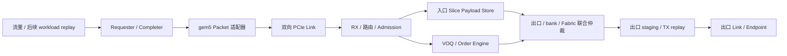

# PCIe 6.0 Switch gem5 仿真架构

状态：设计提案，尚未实现。本文替换原以独立仿真库和 SimAI 为中心的
方案；gem5 是唯一事件执行内核。硬件结构见
[Switch 架构](PCIe6_Switch_Architecture.md)，需求 ID 见
[需求定义](PCIe6_Switch_Requirements.md)。

## 1. 目标和首版边界

先回答单颗 Switch 的吞吐、时延、缓存、反压和公平性问题，再扩展级联
和 AI 通信。首版采用 synthetic Root/Endpoint，单透明域、固定层次路由、
VC0、MemWr/MemRd/CplD、有限 Tag 和缓存。仿真既检查数据正确性，也检查
协议子集和资源守恒。不能将行为模型作为 PHY、电气或协议合规签核。

完整 OS 枚举、配置 TLP、MSI/MSI-X、ATS/PASID/PRI、Atomic、热插拔、DPC、
NTB、多主机、广播和 INC 不属于首版验收；请求未实现能力时明确拒绝。
Gen5 混代需要独立 non-FLIT profile，不能只替换 Gen6 链路速率。

首版默认 store-and-forward；cut-through 作为后续独立模式，必须定义
头部可路由、接收错误处置、下游预留和尾部释放条件。

## 2. 现有代码与复用边界

| 仓库资产 | 复用方式 | 尚缺能力 |
|---|---|---|
| `src/dev/pci/PciDevice.py`、`device.hh` | Function、BAR、Type-1 配置基础 | TLP/FLIT 与 Tag 生命周期 |
| `PciToPciBridge.py`、`p2p_bridge.*` | PCI 层次与地址窗口的参考/集成点 | Gen6 链路与 Switch 数据面 |
| `PciUpstream.py`、`bus.*`、`up_down_bridge.*` | PCI 地址和配置转发 | 物理端口资源与事务排序 |
| `src/mem/bridge.*`、`noncoherent_xbar.*` | timing port、retry、队列合同参考 | P/NP/Cpl、共享信用、replay |
| 离线 HTML | 参数入口和估算对照 | gem5 时序与协议正确性 |

现有 `PciBus` 是 NoncoherentXBar；其宽度和延迟不代表 PCIe 编码、信用或
重传。新增模型应通过适配器接入，不全局修改已有 PCI 设备的行为。
原方案引用的 SimAI/SimCCL 相对路径不作为本仓库已有依赖。

## 3. 模块结构与时间



所有模块使用 gem5 `Tick`、事件队列与 `ClockedObject`。配置声明时间
分辨率，所有传播与串行化时长向上取整；正服务时间至少一个 Tick。
协议控制状态需要与数据一起推进，不另建 wall-clock 或独立时间循环。
时钟域以各自时钟边沿调度，CDC 用可配置延迟和有限队列抽象。

链路每方向独立串行化；仲裁按请求到达和服务完成触发，不逐 ps 轮询。
同 Tick 的选择使用稳定端口/队列顺序和确定的仲裁状态；随机误码使用
独立 seed。保存配置、seed、版本和流量 trace 后应可重复结果。

## 4. gem5 端口合同

gem5 `Packet` 是内存访问封装，不直接等同 TLP。适配器创建独立的事务
对象，保存 `flow_id`、`transaction_id`、Requester ID、Tag、地址、长度、
class、TC/VC、ordering domain 和父请求。Tag 不使用 workload 消息 tag。

- `recvTimingReq` 返回 false 时，接收方不取得 Packet 所有权，不消耗
  永久资源；资源可用后通知 `sendRetryReq`。发送方保留并重试原包。
- 返回 true 后模型负责完成或显式失败；保存父 Packet 和分段状态。
  入站适配队列必须有限；不能先接受无限 Packet 再在内部等待信用。
- `sendTimingReq` 失败后保留包，等待 `recvReqRetry`。响应发送失败后
  保留响应，等待 `recvRespRetry`；等待期间不得重复执行写入或回调。
- 需要 gem5 响应的写请求由适配器产生一次本地响应，表示源请求被接管，
  不是 PCIe Cpl，也不代表目的可见。显式 sink 通知定义远端可见时刻。
- Read 只有在全部合法 Completion 数据到齐后形成父 Packet 响应；
  检查 offset、长度、状态和重复片段，最后才释放 Tag。

将源资源可复用、目的数据可见、父响应被下游接受分别记账。应用依赖应
等待其声明的完成点；posted write 不能通过虚构网络 Completion 同步。
原子/functional 访问仅作配置和数据检查；默认要求 drain 后访问数据，
不能绕过在途写产生错误的内存视图，也不产生性能统计。

## 5. 端点与事务生成

端点包含有限 DMA 队列、Requester/Function Tag 表、未完成字节窗口、
Completer 服务队列及可配置内存服务带宽。逻辑 Read 的请求方向与数据
方向相反，两条路径都消耗资源。

MemWr 按 MPS 和 4 KiB 边界切分；MemRd 按 MRRS 和 4 KiB 边界切分。
Completer 按适用的 MPS、RCB 和 Completion 规则产生一个或多个 CplD；
RCB 不是无条件的最大 payload。Tag 的可用集合和上限来自显式协议
profile，不沿用 HTML 中 tag 位宽推导表作为规范依据。

首版不支持 RO/IDO 等放宽属性。Ordering 使用规范约束的 eligible
矩阵，保留必要越过关系；不能用“所有事务全局 FIFO”代替前进性设计。
Read/Write fence 与 doorbell 由显式流量/端点语义实现。

## 6. Link 与精度等级

| 等级 | 覆盖 | 结果限制 |
|---|---|---|
| L0 | 字节、容量和割带宽估算 | 不输出可信排队尾延 |
| L1 | TLP 事件、有限资源、链路服务预算、反压 | 信用和 FLIT packing 为明确近似 |
| L2 | FLIT packing、共享信用、ACK/NAK/replay | 按已实现条款逐项声明覆盖 |

Gen6 每 lane 64 GT/s，对应 8 GB/s 单向 raw；x16 为 128 GB/s。
L2 FLIT 为 256 B，包含 236 B TLP 区、6 B DLP、8 B CRC、6 B ECC
（本地 Base Spec §4.2.3，印刷页 350 起）。TLP 区仍含事务头部和填充，
236/256 不是应用 payload 效率。L1 可按此布局计费，但必须记录 packing
近似和 flush 策略；L2 实现跨 FLIT、边界和填充规则后才声明详细 packing。
不得在显式 overhead 之外再乘 HTML 的整体效率因子。

Base Spec §2.6.1（页 236 起）及 §2.6.1.1（页 242 起）区分 dedicated
和 shared FC；Gen6 模型不能只有传统六类 P/NP/Cpl H/D 计数。L1 可采用
保守的 dedicated-resource 抽象，结果标记 `abstract_fc`；L2 必须覆盖
启用 VC 的共享池、消费/更新计数和发送资格规则，附条款与测试矩阵。

TX replay 副本在链路确认前保留，有限 replay 空间也会阻塞新发送。
重传占用 wire 服务，不重复扣新事务信用，也不重复交付 payload。
错误注入、ACK/NAK、超时和恢复状态仅在相应功能完成后启用；L1 的无错
模式必须标记，不能输出未经模拟的 FEC 纠错率。PHY 训练和模拟电路不建模。

## 7. Switch 资源与调度

Payload 归入口 Slice；VOQ 保存 descriptor，不复制整包数据。索引至少
区分出口、VC、class 和 ordering domain。出口选择 eligible 队头，联合
预留 bank 服务、Fabric slot 和出口 staging；失败则不持有部分 grant。
同 Slice 可走本地路径，但使用相同顺序、带宽和资源记账。

| 资源 | 分配时刻 | 释放条件 |
|---|---|---|
| RX credit backing | 对邻居承诺接收空间之前 | 对应资源真正空闲后发送 FC 更新 |
| payload sector / descriptor | Admission 成功 | 数据受下一级保护且引用归零 |
| bank / Fabric slot | 本轮联合 grant | 服务完成事件 |
| egress staging | 授权读取之前 | 交给有空间的 TX replay/link |
| replay copy | 新 FLIT 发出之前 | 有效 ACK 或显式恢复清理 |
| Requester Tag | MemRd 发起 | 全部响应到齐或已定义失败收束 |

外部接收保证必须包含已通告但尚未到达的流量。释放 core sector 并不
自动返还所有外链信用；RX 与 core 的所有权转移必须有 backing 证明。
信用更新存在传播和处理延迟，不能按固定 RTT 无条件回收。

初始仲裁为 eligible 队列间 round-robin，结合独立 P/NP/Cpl 保留池与
age 统计。建立资源依赖图，确认 Completion 不等待被其阻塞的请求资源；
只增加 VC 或保留池不能证明无死锁。流量停止后必须在无故障条件下排空。
拥塞只产生等待和逐跳反压，不静默丢包。

## 8. 配置、实验与统计

统一 JSON schema，Python 配置校验后构建 SimObjects。交换格式时间为
整数 ps、容量为 B、速率为 B/s；转换到 Tick 时记录舍入。拒绝非法端口/
lane 组合、不连通地址域、未知能力和容量不足的固定资源配置。

144-lane 探索点为一个 x16 上联加八个 x16 下联，三个 48-lane Slice。
每 Slice 1 MiB、16 banks、64 KiB/bank、512-bit 1R1W@1 GHz，内部每方向
512 GB/s 都是可扫描假设。SRAM、descriptor、RX、staging、replay 分别计容。
Fabric 通道数与物理 Slice 数分开；读写带宽分别限制，metadata 和 sector
rounding 计入实际开销。基线不等于已证明无阻塞或可实现的 SRAM macro。

首组实验：空载单流、双向、置换、incast、hotspot、同/跨 Slice、短包与
大包、Read/Write 混合、出口降速。提供给定注入率与闭环有限窗口两种模式。
长时间过载报告积压增长和未完成量，不把截短样本称为稳定 P99。

结果绑定 normalized config hash、git revision/dirty 状态、seed、精度、
协议子集、预热/测量/排空窗口和校准来源。分别输出 payload/TLP/FLIT/
Fabric 字节、每方向利用率、吞吐、时延分布和样本数、Tag/credit/bank/
VOQ/replay stall、资源峰值和未完成请求。记录 core latency 的入口/出口
边界、端点完成和 RTT；不重复叠加完整 RTT 与逐段延迟。

## 9. 源码组织与集成阶段

以下均为计划路径，不能作为已经存在的模块或运行命令：

```text
src/dev/pci/pcie/           # SimObjects、TLP、link、endpoint、switch
src/dev/pci/pcie/SConscript # 注册源文件、SimObjects 和 GTests
configs/example/pcie/      # synthetic 单 switch 与级联实验
tests/gem5/pcie/           # TestLib 集成
```

纯事务/资源逻辑与 gem5 端口适配分开，便于 GTest。注册须由上级 SConscript
显式纳入；不要假定创建目录就能构建。新增源文件前确定版权持有人。

先用 synthetic 端点验证，再将 Type-1 配置功能接到相同转发核心。配置
地址、总线号和窗口变更必须同步到路由表；已有桥不能形成绕开 PCIe 模型
的并行快捷路径。完整系统阶段另验枚举、BAR/P2P、DMA 和中断。

后续 SimAI/SimCCL 仅负责生成带依赖的 FlowIR，由 gem5 完成事件推进任务。
离线 trace 缺失依赖时只能称为 traffic replay。HTML 首版通过导出配置、
运行 gem5、导入结果对接；其旧校准 JSON 中派生值不能自动变成实测输入。
Mesh/Clos 探索使用独立模式，标准透明模式只接受合法层次和地址路由。

## 10. 交付与验收

| 阶段 | 交付 | 验收 / 需求追踪 |
|---|---|---|
| M0 | schema、事务与资源模型 | 非法配置拒绝；确定性、分段与守恒测试；F-01/06 |
| M1 | 单链路和 synthetic endpoints | Read 数据匹配、Tag 释放、双向独立、retry 恰好一次；P-02/03 |
| M2 | 单 Switch L1 | incast 反压、VOQ 隔离、bank/Fabric 瓶颈、排空；A-01 至 A-04 |
| M3 | Gen6 L2 | packing、共享 FC、replay、错误重复抑制条款测试；F-06、IP-07 |
| M4 | 层次级联与 PCI 集成 | 请求/Completion 路径、地址更新、枚举与 P2P；F-01/02/05 |
| M5 | workload 和可选服务 | 依赖驱动流量；广播引用和 INC 数值独立验收；F-10 至 F-14 |

GTest 覆盖 allocator、引用、排序矩阵、分段重组和仲裁；小型 gem5 timing
测试覆盖 request/response retry、有限队列和事件交互。资源故意缩小时
必须出现对应 stall，不能以无限队列保持吞吐。数据总量、Tag、credit、
sector、descriptor 在排空后守恒；错误路径无泄漏、双释放和重复回调。

先验证解析预算和单资源瓶颈，再对照 RTL/VIP/实测校准；保存测点和误差
适用范围。现阶段未构建或运行 PCIe 模型，没有性能结果。
