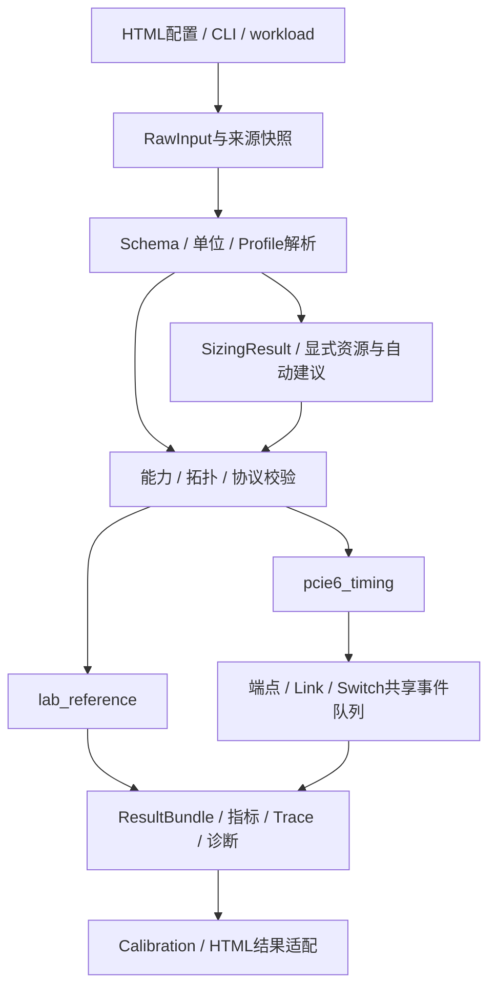

# PCIe 6.0 Switch gem5 仿真架构

版本：v1.0｜日期：2026-11-17｜状态：待实现方案，无仿真结果。
依据[需求v0.9](PCIe6_Switch_Requirements.md)，硬件资源见
[Switch架构](PCIe6_Switch_Architecture.md)，阶段与证据见
[实施计划](PCIe6_Implementation_Plan.md)。

## 1. 执行模型与配置维度

Base Spec 6.0定义协议，HTML定义功能和参考行为；databook是实现补充，
竞品spec是独立目标层。gem5是时序执行内核，不新增并行推进的独立时钟。

| 配置维度 | 取值 | 合同 |
|---|---|---|
| `execution_mode` | `lab_reference` / `pcie6_timing` | 参考近似与有限资源模型分开运行 |
| `link_fidelity` | `tlp_budget` / `flit_detail` | 按实际覆盖条款声明精度 |
| `interface_model` | `transaction` / `controller_detail` | DWC beat级细化可选 |
| `scenario_profile` | `html_default` / `competitor_target` / 自定义 | 输入覆盖与目标，不改变协议规则 |
| `microarchitecture` | 基础共享池 / 显式slice-bank | 物理映射、容量和服务量可核算 |

`lab_reference`固定参考语义，不接受`flit_detail`或beat细化混搭。
`pcie6_timing/tlp_budget`是协议子集与服务近似，不等于FLIT合规模型。
不支持的组合拒绝并指出缺失能力，不能静默降精度。

参考公式可在纯Python工具运行；参考事件模型移植到gem5事件队列。
现有HTML JS仅用于oracle，不与gem5共同推进同一实验。内部同Tick事件
按稳定sequence/资源顺序调度，与JS参考排序的差异需要回归确认。

## 2. 从输入到结果



原始输入不变，解析后有效值另存。所有63字段都有schema、默认值、范围、
条件、单位、adapter映射和测试索引，字段表唯一来源为需求§5/HTML。
新增端点角色、TC/VC映射、RX backing、Shared FC、bank和replay等详细
参数放在版本化扩展区，不能伪称HTML已经提供。

输入优先级为HTML默认→显式场景profile覆盖→用户显式覆盖；每次覆盖
保存diff和来源。0=自动在覆盖之后统一解析。显式容量不足不能被自动值
替换；无足够信息时拒绝严格模式或要求显式参考模式。

## 3. 数据对象与接口

| 对象 | 核心字段/用途 |
|---|---|
| `ExperimentSpec` | schema、execution/fidelity/interface/profile、seed、source hashes、raw/effective inputs |
| `ProtocolProfile` | 规范版本、端点角色、MPS/MRRS/RCB、Tag能力/enable、VC/FC能力、支持子集 |
| `TopologyIR` | port/link IDs、方向/宽度/速率/模式、域、地址和bus范围 |
| `FlowIR` | flow/application ID、字节、地址、release/dependencies、完成合同 |
| `Transaction` | parent ID、Requester/Function/Tag、地址/长度、class/TC/VC/属性、重组进度 |
| `ResourceProfile` | RX、payload、descriptor、VOQ、bank、Fabric、staging、replay预算 |
| `SizingResult` | 推导中间值、建议/有效值、各限制项及资源诊断 |
| `ResultBundle` | 实际模式/覆盖、配置hash、版本/dirty、窗口、样本/未完成、metrics/trace/目标评估 |

workload消息tag、应用ID和PCIe Tag分别命名；集合通信chunk不是TLP。
同一flow可拆成多个请求，每请求可返回多个CplD。父应用只有其声明的
完成合同满足后才推进依赖。

## 4. 模块和gem5接入

| 计划组件 | 责任 | 首次交付 |
|---|---|---|
| schema/sizing/adapter工具 | HTML字段、自动值、格式转换、规范诊断 | M0/M1 |
| `PcieLabReference` | HTML事件语义与指标，参考mode专用 | M1 |
| `PcieTrafficSource` | steady/burst、闭环窗口、后续FlowIR | M2 |
| `PcieRequester/Completer` | Function/Tag、分段/重组、端点服务 | M2 |
| `PcieLink/PciePort` | 双方向服务、RX backing、FC/replay粒度 | M2/M3 |
| `PcieSwitchCore` | 路由/ordering、有限缓存、VOQ、仲裁/Fabric/staging | M2 |
| `PciePacketAdapter` | gem5 Packet与内部事务的所有权/完成适配 | M2 |
| `PcieConfigProxy/ControllerDetail` | 可选DBI/配置/beat合同 | M5 |
| metrics/result适配 | 时间戳、字节、峰值、stall、目标报告 | 各阶段 |

组件可先共用SimObject，纯逻辑与端口适配分离，避免SimObject数量决定
模型粒度。现有`src/dev/pci`设备/桥提供配置和地址参考，`src/mem/bridge.*`
提供timing/retry合同参考；普通PciBus宽度或延迟不等于PCIe6链路模型。
完整系统接入后不得留下绕过新数据面的旧桥快捷路径。

### 4.1 Packet所有权和完成

- `recvTimingReq=false`：发送方保留包，接收方不持有永久资源；可接收后
  通知retry。返回true则模型负责恰好一次完成或显式失败。
- 发送请求失败等待`recvReqRetry`；发送响应失败保存响应并等待
  `recvRespRetry`。不能重做已经提交的写或重复回调。
- 若需对gem5写请求返回响应，adapter可在有限本地资源接管数据后响应，
  表示源可复用，不是网络Cpl。目的可见由另一个sink完成事件定义。
- Read在全部合法Cpl数据到齐后形成父响应，Tag独立按该请求状态释放。
  响应阻塞期间仍要持有最终数据，不能提前腾空重组存储。
- functional/atomic仅用于drain后的配置/数据检查，不产生性能结果；
  首版不支持绕过在途写的functional访问。

## 5. 事件、资源与前进性

使用gem5 Tick/ClockedObject；配置时间分辨率，服务时间向上取整并记录
误差，正服务至少一Tick。传播、时钟边沿和CDC分别建模，不逐ps轮询。
随机误码使用独立seed；事件平局规则、输入和版本足以复现小案例。

TLP子集事件为inject、Tag/Cpl-reserve、link-send/arrive、rx-validate、
core-admit、arbitrate、fabric/staging-complete、FC-update和completion。
详细模式再加入FLIT pack/flush、ACK/NAK、timeout/replay与接收重复抑制。

| 资源 | 获取/释放合同 |
|---|---|
| RX backing/外链credit | 对外承诺前预留；真实RX空间释放且更新到达后才重新可用 |
| core sector/descriptor | Admission原子分配；移交保护副本且引用归零后释放 |
| Fabric/bank服务 | 联合grant选择；服务结束释放slot，不形成部分持有环 |
| egress staging | 从入口取数前预留；TX受保护接管后释放 |
| replay | 新发送前检查空间；确认或明确恢复清理后释放 |
| Tag/Cpl预算 | 本地NP发起前预留；数据完成/失败后按账本分别归还 |

守恒检查包含已用/预留/在途/空闲，不只比较队列当前长度。Completion/
请求保留池配合ordering eligible矩阵、资源依赖图和排空测试；单靠增加VC
不证明无死锁。长期过载报告积压增长和未完成量，不报告稳定P99保证。

## 6. HTML兼容和协议差异

参考sizing严格对应`sizeHardware`，参考事件对应`simulateHardware`。

| 项目 | `lab_reference` | `pcie6_timing` |
|---|---|---|
| 头部/packing | 可调开销与236/256×packing | 事务格式/OHC与所声明packing粒度 |
| RCB/Tag | 页面选择及编码预算表 | 端点角色、能力/enable/合法Tag集合 |
| credit/replay | 定时信用回收、replay窗口限速 | 资源backing；详细模式确认/重传 |
| VOQ/pool/egress | 峰值与容量比较 | 入队前预留，实际反压 |
| Fabric | FIFO聚合服务率 | 有限并行通道；可选bank/物理分区 |
| latency | 分段请求首link launch至完成 | 同时输出含注入等待的事务/应用时延 |
| 窗口 | 30000 packet预算、前20%预热及截短 | 显式warmup/measurement/drain，截短/超时另记 |

`slices/fabricSlices`映射并行服务通道，物理Slice另加字段。
`poolKiB`是每入口有效payload输入；descriptor及ECC/对齐预算分开。
`util`是参考折减，详细模型不能在实际冲突外再无解释重复折减。
`fixedRtt`是输入预算而不是覆盖真实路径的延迟；按需求§6解释参考残余
与严格模式分项服务差异，不出现负端点残余抵消物理延迟。

参考bench S-01–S-07按HTML默认值和阈值运行；严格模式S-08要求实际
反压/守恒/排空。严格模式允许输出不同吞吐/尾延，差异必须有资源或
规范原因，不能为了对齐参考值取消反压或修改RCB规则。

## 7. 指标、格式与结果适配

输出payload/TLP/FLIT或其估算/Cell字节、逐方向利用率、每发起端口吞吐、
请求/Cpl率、P50/P99/P999、样本、Tag/credit/bank/Fabric/replay等待与
资源峰值；重传字节不计应用有效吞吐。与HTML同名指标必须同单位/测点。

分别记录arrival、first-launch、RX/core-entry、egress、destination-visible、
last-Cpl与application-done；写入源可复用与目的可见分开。报告单请求、
应用、core和RTT分布，不能混用样本。配置变更后旧结果保持旧hash。

保留`pcie6-hardware-calibration-v1`全部字段及null语义，新增metadata
或版本化ResultBundle承载gem5结果，不重命名旧字段。顶栏workspace
`schema:1`与hardware-calibration不同，不能直接共用导入器。

HTML→CLI→运行→ResultBundle→页面导入是计划接口，当前页面无此后端
导入。参考输出不能标作实测；不兼容schema/单位/配置hash时显式拒绝。

## 8. 竞品目标与可选细化

`competitor_target`仅合并输入覆盖与目标表达式，输出每项状态：未运行、
缺能力、测点不可比、假设待核实、达到/未达到当前实验目标。
达到实验阈值不等于达到硅实测规格；固定switchNs不能证明90ns C/T目标。
COMP-01–COMP-18按硬件架构§7分组，冻结条件继承需求§11.1。

`controller_detail`再加入TRGT1已grant未到达的预留、class halt传播、
XALI稳定/连续供数、内部Msg/Cpl争用、DSP DBI代理和CFG1→CFG0转换。
其F-23–F-32测试不替代Gen6条款测试；Gen5 RAM/replay规则不直接迁移。
当前补充databook不在工作区，恢复版本并核对后才执行其接口细化。

## 9. 计划源码与验证边界

以下均为拟新增路径，不是已经存在的模块或可执行命令：

```text
util/pcie_lab/              # schema/sizing/JSON/result与参考提取工具
src/dev/pci/pcie/           # transaction/link/endpoint/switch/adapter
src/dev/pci/pcie/SConscript # 源码、SimObjects、GTests注册
configs/example/pcie/      # 硬件页单颗/级联配置与profile
tests/gem5/pcie/           # TestLib回归
```

实现时核对仓库SConscript递归发现规则和目标注册，不凭目录存在假定构建
成功。新增源文件先确定版权；保持已有设备配置兼容，避免改动通用Packet
语义。dev/mem当前为orphaned，准备跨模块PR时重新检查MAINTAINERS。

验证按层：schema/解析公式及分段GTest；小型gem5 timing验证retry/所有权/
有限资源；TestLib验证端到端和JSON；FLIT条款用独立expected traces，
参考JS仅做参考语义oracle，不作为严格协议oracle。实际命令和证据在
[实施计划](PCIe6_Implementation_Plan.md)登记，未运行不标通过。
