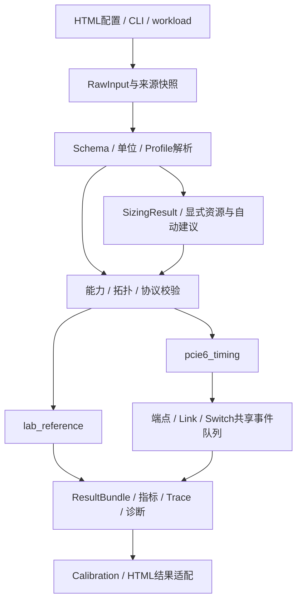
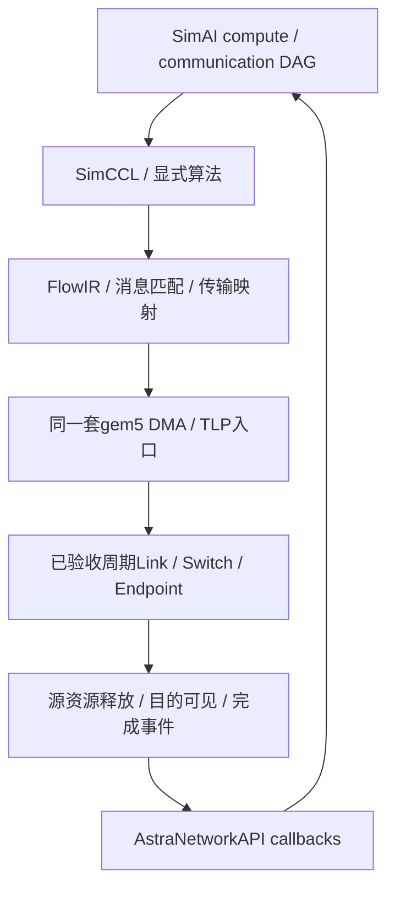

# PCIe 6.0 Switch gem5 仿真架构

版本：v1.1｜日期：2026-11-17｜状态：M0 host配置合同已实现；数据面待实现，无仿真结果。
依据[需求v1.0](PCIe6_Switch_Requirements.md)，硬件资源见
[Switch架构](PCIe6_Switch_Architecture.md)，阶段与证据见
[实施计划](PCIe6_Implementation_Plan.md)。

## 1. 执行模型与配置维度

TDD不改变本架构：先为具体实现任务构造输入、expected/checker与退出
条件，再实现gem5组件并回归。[场景目录](PCIe6_Validation_Scenarios.md)
是测试设计，实施计划M0–M5是功能交付顺序；不以模型降低流程替换二者。

Base Spec 6.0定义协议，HTML定义功能和参考行为；databook是实现补充，
竞品spec是独立目标层。gem5是时序执行内核，不新增并行推进的独立时钟。

| 配置维度 | 取值 | 合同 |
|---|---|---|
| `execution_mode` | `lab_reference` / `pcie6_timing` | 参考近似与有限资源模型分开运行 |
| `link_fidelity` | `tlp_budget` / `flit_detail` | 按实际覆盖条款声明精度 |
| `interface_model` | `transaction` / `controller_detail` | DWC beat级细化可选 |
| `scenario_profile` | `html_default` / `competitor_target` / 自定义 | 输入覆盖与目标，不改变协议规则 |
| `microarchitecture` | 基础共享池 / 显式slice-bank | 物理映射、容量和服务量可核算 |

`lab_reference`固定参考语义，不接受`flit_detail`或beat细化混搭。
`pcie6_timing/tlp_budget`是协议子集与服务近似，不等于FLIT合规模型。
不支持的组合拒绝并指出缺失能力，不能静默降精度。

参考公式可在纯Python工具运行；参考事件模型移植到gem5事件队列。
现有HTML JS仅用于oracle，不与gem5共同推进同一实验。内部同Tick事件
按稳定sequence/资源顺序调度，与JS参考排序的差异需要回归确认。

## 2. 从输入到结果



原始输入不变，解析后有效值另存。所有63字段都有schema、默认值、范围、
条件、单位、adapter映射和测试索引，字段表唯一来源为需求§5/HTML。
新增端点角色、TC/VC映射、RX backing、Shared FC、bank和replay等详细
参数放在版本化扩展区，不能伪称HTML已经提供。

输入优先级为HTML默认→显式场景profile覆盖→用户显式覆盖；每次覆盖
保存diff和来源。0=自动在覆盖之后统一解析。显式容量不足不能被自动值
替换；无足够信息时拒绝严格模式或要求显式参考模式。

## 3. 数据对象与接口

| 对象 | 核心字段/用途 |
|---|---|
| `ExperimentSpec` | schema、execution/fidelity/interface/profile、seed、source hashes、raw/effective inputs |
| `ProtocolProfile` | 规范版本、端点角色、MPS/MRRS/RCB、Tag能力/enable、VC/FC能力、支持子集 |
| `TopologyIR` | port/link IDs、方向/宽度/速率/模式、域、地址和bus范围 |
| `FlowIR` | flow/application ID、字节、地址、release/dependencies、完成合同 |
| `Transaction` | parent ID、Requester/Function/Tag、地址/长度、class/TC/VC/属性、重组进度 |
| `ResourceProfile` | RX、payload、descriptor、VOQ、bank、Fabric、staging、replay预算 |
| `SizingResult` | 推导中间值、建议/有效值、各限制项及资源诊断 |
| `ResultBundle` | 实际模式/覆盖、配置hash、版本/dirty、窗口、样本/未完成、metrics/trace/目标评估 |

workload消息tag、应用ID和PCIe Tag分别命名；集合通信chunk不是TLP。
同一flow可拆成多个请求，每请求可返回多个CplD。父应用只有其声明的
完成合同满足后才推进依赖。

## 4. 模块和gem5接入

| 计划组件 | 责任 | 首次交付 |
|---|---|---|
| schema/sizing/adapter工具 | HTML字段、自动值、格式转换、规范诊断 | M0/M1 |
| `PcieLabReference` | HTML事件语义与指标，参考mode专用 | M1 |
| `PcieTrafficSource` | steady/burst、闭环窗口、后续FlowIR | M2 |
| `PcieRequester/Completer` | Function/Tag、分段/重组、端点服务 | M2 |
| `PcieLink/PciePort` | 双方向服务、RX backing、FC/replay粒度 | M2/M3 |
| `PcieSwitchCore` | 路由/ordering、有限缓存、VOQ、仲裁/Fabric/staging | M2 |
| `PciePacketAdapter` | gem5 Packet与内部事务的所有权/完成适配 | M2 |
| `PcieConfigProxy/ControllerDetail` | 可选DBI/配置/beat合同 | M5 |
| metrics/result适配 | 时间戳、字节、峰值、stall、目标报告 | 各阶段 |

组件可先共用SimObject，纯逻辑与端口适配分离，避免SimObject数量决定
模型粒度。现有`src/dev/pci`设备/桥提供配置和地址参考，`src/mem/bridge.*`
提供timing/retry合同参考；普通PciBus宽度或延迟不等于PCIe6链路模型。
完整系统接入后不得留下绕过新数据面的旧桥快捷路径。

### 4.1 Packet所有权和完成

- `recvTimingReq=false`：发送方保留包，接收方不持有永久资源；可接收后
  通知retry。返回true则模型负责恰好一次完成或显式失败。
- 发送请求失败等待`recvReqRetry`；发送响应失败保存响应并等待
  `recvRespRetry`。不能重做已经提交的写或重复回调。
- 若需对gem5写请求返回响应，adapter可在有限本地资源接管数据后响应，
  表示源可复用，不是网络Cpl。目的可见由另一个sink完成事件定义。
- Read在全部合法Cpl数据到齐后形成父响应，Tag独立按该请求状态释放。
  响应阻塞期间仍要持有最终数据，不能提前腾空重组存储。
- functional/atomic仅用于drain后的配置/数据检查，不产生性能结果；
  首版不支持绕过在途写的functional访问。

## 5. 事件、资源与前进性

使用gem5 Tick/ClockedObject；配置时间分辨率，服务时间向上取整并记录
误差，正服务至少一Tick。传播、时钟边沿和CDC分别建模，不逐ps轮询。
随机误码使用独立seed；事件平局规则、输入和版本足以复现小案例。

TLP子集事件为inject、Tag/Cpl-reserve、link-send/arrive、rx-validate、
core-admit、arbitrate、fabric/staging-complete、FC-update和completion。
详细模式再加入FLIT pack/flush、ACK/NAK、timeout/replay与接收重复抑制。

| 资源 | 获取/释放合同 |
|---|---|
| RX backing/外链credit | 对外承诺前预留；真实RX空间释放且更新到达后才重新可用 |
| core sector/descriptor | Admission原子分配；移交保护副本且引用归零后释放 |
| Fabric/bank服务 | 联合grant选择；服务结束释放slot，不形成部分持有环 |
| egress staging | 从入口取数前预留；TX受保护接管后释放 |
| replay | 新发送前检查空间；确认或明确恢复清理后释放 |
| Tag/Cpl预算 | 本地NP发起前预留；数据完成/失败后按账本分别归还 |

守恒检查包含已用/预留/在途/空闲，不只比较队列当前长度。Completion/
请求保留池配合ordering eligible矩阵、资源依赖图和排空测试；单靠增加VC
不证明无死锁。长期过载报告积压增长和未完成量，不报告稳定P99保证。

## 6. HTML兼容和协议差异

参考sizing严格对应`sizeHardware`，参考事件对应`simulateHardware`。

| 项目 | `lab_reference` | `pcie6_timing` |
|---|---|---|
| 头部/packing | 可调开销与236/256×packing | 事务格式/OHC与所声明packing粒度 |
| RCB/Tag | 页面选择及编码预算表 | 端点角色、能力/enable/合法Tag集合 |
| credit/replay | 定时信用回收、replay窗口限速 | 资源backing；详细模式确认/重传 |
| VOQ/pool/egress | 峰值与容量比较 | 入队前预留，实际反压 |
| Fabric | FIFO聚合服务率 | 有限并行通道；可选bank/物理分区 |
| latency | 分段请求首link launch至完成 | 同时输出含注入等待的事务/应用时延 |
| 窗口 | 30000 packet预算、前20%预热及截短 | 显式warmup/measurement/drain，截短/超时另记 |

`slices/fabricSlices`映射并行服务通道，物理Slice另加字段。
`poolKiB`是每入口有效payload输入；descriptor及ECC/对齐预算分开。
`util`是参考折减，详细模型不能在实际冲突外再无解释重复折减。
`fixedRtt`是输入预算而不是覆盖真实路径的延迟；按需求§6解释参考残余
与严格模式分项服务差异，不出现负端点残余抵消物理延迟。

参考bench S-01–S-07按HTML默认值和阈值运行；严格模式S-08要求实际
反压/守恒/排空。严格模式允许输出不同吞吐/尾延，差异必须有资源或
规范原因，不能为了对齐参考值取消反压或修改RCB规则。

## 7. 指标、格式与结果适配

输出payload/TLP/FLIT或其估算/Cell字节、逐方向利用率、每发起端口吞吐、
请求/Cpl率、P50/P99/P999、样本、Tag/credit/bank/Fabric/replay等待与
资源峰值；重传字节不计应用有效吞吐。与HTML同名指标必须同单位/测点。

分别记录arrival、first-launch、RX/core-entry、egress、destination-visible、
last-Cpl与application-done；写入源可复用与目的可见分开。报告单请求、
应用、core和RTT分布，不能混用样本。配置变更后旧结果保持旧hash。

保留`pcie6-hardware-calibration-v1`全部字段及null语义，新增metadata
或版本化ResultBundle承载gem5结果，不重命名旧字段。顶栏workspace
`schema:1`与hardware-calibration不同，不能直接共用导入器。

HTML→CLI→运行→ResultBundle→页面导入是计划接口，当前页面无此后端
导入。参考输出不能标作实测；不兼容schema/单位/配置hash时显式拒绝。

## 8. 竞品目标与可选细化

`competitor_target`仅合并输入覆盖与目标表达式，输出每项状态：未运行、
缺能力、测点不可比、假设待核实、达到/未达到当前实验目标。
达到实验阈值不等于达到硅实测规格；固定switchNs不能证明90ns C/T目标。
COMP-01–COMP-18按硬件架构§7分组，冻结条件继承需求§11.1。

`controller_detail`再加入TRGT1已grant未到达的预留、class halt传播、
XALI稳定/连续供数、内部Msg/Cpl争用、DSP DBI代理和CFG1→CFG0转换。
其F-23–F-32测试不替代Gen6条款测试；Gen5 RAM/replay规则不直接迁移。
当前补充databook不在工作区，恢复版本并核对后才执行其接口细化。

## 9. 计划源码与验证边界

以下均为拟新增路径，不是已经存在的模块或可执行命令：

```text
util/pcie_lab/              # schema/sizing/JSON/result与参考提取工具
src/dev/pci/pcie/           # transaction/link/endpoint/switch/adapter
src/dev/pci/pcie/SConscript # 源码、SimObjects、GTests注册
configs/example/pcie/      # 硬件页单颗/级联配置与profile
tests/gem5/pcie/           # TestLib回归
```

实现时核对仓库SConscript递归发现规则和目标注册，不凭目录存在假定构建
成功。新增源文件先确定版权；保持已有设备配置兼容，避免改动通用Packet
语义。dev/mem当前为orphaned，准备跨模块PR时重新检查MAINTAINERS。

验证按层：schema/解析公式及分段GTest；小型gem5 timing验证retry/所有权/
有限资源；TestLib验证端到端和JSON；FLIT条款用独立expected traces，
参考JS仅做参考语义oracle，不作为严格协议oracle。实际命令和证据在
[实施计划](PCIe6_Implementation_Plan.md)登记，未运行不标通过。

## 10. 关键实现算法与TDD观察点

以下补充具体数据面实现，不增加新的实现层级或替换前述模块。

### 10.1 请求与完成路径

1. TrafficSource生成应用传输；Requester按MPS/MRRS/4KiB拆分。每个
   MemRd预留Tag及相应Cpl接收预算，保留父应用/片段映射。
2. Link发送资格同时检查方向串行化状态、对端FC和所选replay模型；
   接收进入有backing的RX队列。TLP预算和详细FLIT各自声明事件粒度。
3. S/F校验成功后route lookup选择出口，Order Engine产生eligible；
   Admission原子预留core sector/descriptor，安排RX→core写入；数据到齐
   DATA_READY后才允许仲裁，源RX副本释放单列事件。
4. VOQ保存descriptor与payload引用，Scheduler被入队、资源释放或服务
   完成事件唤醒。联合检查bank/Fabric/staging，失败保留队头及原因。
5. grant后生成有限服务完成事件；出口取得保护副本后才释放入口引用。
   TX按链路资源发送，确认/recovery事件释放相应replay状态。
6. Completer生成反向CplD，同样经过各跳资源。Requester检查身份、范围、
   状态与重组进度，最后一片到齐后释放Tag，父应用所需片段全齐才完成。

每步提供接受/提交/释放trace。TDD分别注入容量耗尽、错误身份、返回乱序
或重试等条件，检查没有部分预留泄漏、重复提交及过早完成。

### 10.2 唤醒、顺序与排空

每个阻塞队列记录所等待资源；资源状态转换只唤醒有关仲裁/发送事件。
同一资源的调度事件有pending状态，避免重复安排同Tick grant。credit
返回、staging释放、bank完成与新入队的平局顺序固定并进入回归合同。

公共资源断言分别检查used/reserved/free及在途所有权；队列峰值不是
有限容量执行的替代。drain先停止新应用注入，继续处理请求/Cpl/FC/ACK
事件，直到队列、未完成表和保护副本达到该profile定义的空闲条件。
等待超过场景预算输出原因/等待图，不强行释放资源以伪装排空。

### 10.3 每项实现的最小测试单元

分段、route、eligible、allocator和RR选择可先用独立函数/GTest验证；
这些是同一gem5实现的单元测试边界，不是必须先开发另一套整机模型。
Packet retry、事件顺序、跨组件反压和完成点使用小型gem5 timing测试；
HTML参考与协议expected分别来自页面oracle和规范fixture。

阶段退出规则及具体V-ID集中于实施计划/场景文档。实现和测试都围绕
本架构的端点、Link、RX/core、VOQ/Fabric、staging/replay和adapter展开。

## 11. gem5周期模型验收后的SimAI集成

规范性集成需求见需求文档§12的SIM-01–SIM-16；本节定义如何实现。

### 11.1 参考与分工

已阅读SimAI侧
[PCIe6_Simulation_Architecture.md](/workspaces/SimAI/docs/pcie_switch/PCIe6_Simulation_Architecture.md)
及其§4/5/8/10，并核对当前
[AstraNetworkAPI.hh](/workspaces/SimAI/astra-sim-alibabacloud/astra-sim/system/AstraNetworkAPI.hh)、
NS3前端和SimCCL架构。该文档提出的统一实验描述、FlowIR、完成依赖和
分级校准保留；其中“独立pcie-sim事件库”在本项目由已验证的gem5模型
承担，不再另做一套Switch/credit/replay实现。

| 层 | 负责内容 | 不负责内容 |
|---|---|---|
| SimAI | 模型/compute与通信依赖、rank、任务推进 | 不直接操纵PCIe信用、VOQ或TLP Tag |
| SimCCL | collective算法、channel/chunk/flow与依赖 | 不是实际GPU kernel，不替代PCIe数据面 |
| `PcieNetwork`（计划） | AstraNetworkAPI、消息匹配、FlowIR、callback生命周期 | 不拥有独立网络时间/独立Switch模型 |
| gem5 PCIe runtime | DMA/TLP、端点、Link、Switch、FC/replay、周期争用 | 不用固定带宽公式替代实际资源服务 |
| result adapter | workload/flow/transaction/cycle trace关联 | 不把估算、cycle模型和实测混标 |

当前API的BackendType为NotSpecified/Garnet/NS3/Analytical，无PCIe；
实际方法名为`sim_get_time`。SimCCL flowTag已有algorithm/protocol/channel/
chunk等字段，算法可能依赖NVSwitch能力，NS3路径存在send_lat表。
这些是本次源码核查结果，不表示PCIe adapter已存在。

### 11.2 顺序与周期验收门

M0–M3继续实现和验证gem5模型。M2的TLP预算/有限资源通过只是基础门；
M3另加周期合同验收：端口解析TLP/cycle、bank读写、仲裁周期、Fabric/
staging、时钟与CDC、占用/释放边沿有独立expected traces。所选FLIT/FC/
replay覆盖及小规模无错/注错场景通过后，冻结cycle profile与source hash。
这不要求完整PHY/全部可选协议合规，但所有未支持项必须显式列出。

SimAI接入执行须在上述门通过后。M4的JSON/UI准备可先做；不在预算模型
阶段就把接口通了称为“已集成cycle-level SimAI”。也不等待全部M5可选
产品功能才做基本PCIe-only workload。

### 11.3 数据和时序闭环



所有rank的PcieNetwork共享一个runtime、topology与gem5 event queue。
先采用单进程、单事件驱动执行，gem5 runner负责初始化、驱动、drain与退出；
SimAI计算/控制事件也通过`sim_schedule`进入同一队列，不运行NS3/AnaSim
来独立推进本次PCIe实验。多进程/分布式同步不作为首版集成条件。

`sim_get_time`、`sim_schedule(delta)`和`sim_time_resolution`声明一致
单位；当前API有SE/MS/US/NS/FS枚举而无PS。adapter显式填写返回单位，
按调用链审查建立转换，内部整数Tick/ps转换要处理舍入/溢出/负delta。
现有前端部分调用只使用time_val，不能照抄而假设time_res始终有效。
同Tick callback稳定排序，经gem5事件延后调用，避免inline重入破坏DAG状态。

### 11.4 API与完成合同

| API | 实现合同 |
|---|---|
| `get_backend_type` | 增加PCIe枚举并审查QueueLevelHandler及backend分支，保持已有backend兼容 |
| `sim_init/sim_comm_size` | 验证共享runtime、rank/communicator、endpoint映射与地址窗口 |
| `sim_send` | 保存message/flow身份及callback；明确count/type到byte的规则；映射到有界DMA入口 |
| `sim_recv` | 注册匹配意图；支持recv先到或数据先到；不能每次调用都另造一份网络流量 |
| `sim_get_time/sim_schedule` | 共享gem5时间、相对事件与确定排序，保证因果不回退 |
| `sim_finish` | 每rank完成登记；全部rank和callback/队列满足drain合同后统一退出，不因一rank结束退出进程 |

匹配键至少含communicator、src/dst、消息tag、channel/chunk/flow或稳定序号；
相同tag重复/并发采用FIFO或显式sequence合同。消息tag不作PCIe Tag。
必须复制需要持久化的元数据并明确buffer/request/callback arg的生命周期，
不能长期保存指向调用栈或临时flowTag的引用。

当前调用链不能假定会因sim_send返回值而自动重试。adapter的等待状态
和DMA容量有界，满时必须通过明确的上游注入窗口控制；未能提供容量
合同则拒绝配置/显式失败，不能静默丢请求或新增无限pending payload队列。
消息匹配记录与硬件接收信用分账，recv登记不消耗虚构TLP资源。

send callback按transport声明的源buffer可复用时刻触发；recv callback
必须等待全消息目的可见且匹配成立。源接管不等于远端完成，posted write
不虚构网络Cpl。read-pull由目的端发MemRd并等全部CplD，方向不能颠倒。
每份callback恰好一次，DAG依赖在其要求的接收/同步完成点释放。

count/type的byte语义、调用者对send callback的依赖及partial matching
必须先按SimAI调用链验证，再冻结API合同；不能直接照搬NS3 hash表键。
端点服务可用抽象内存与确定地址窗口，无须真实GPU内存；验证数据正确性
时使用pattern/checksum fixture，性能运行的abstract-payload模式单独标记。

### 11.5 SimCCL、拓扑与延迟

保留FlowIR的算法/protocol/channel/chunk、predecessors、communicator与
placement；单个chunk可拆多个应用请求/TLP，不丢失父子映射。
PCIe-only禁止自动选NVLS/NVSwitch依赖路径；Ring/Tree在端点执行归约，
需要其服务成本，普通Switch不因collective类型自动获得INC能力。

绕过NS3 NVLink/NET send_lat和RDMA/PFC等机制；端点启动开销如需保留，
放入显式可校准的PCIe端点profile，避免与gem5 DMA/Link时延双计。
star/树先验收；CPU staging要生成两段DMA与Host服务；mesh/Clos仍需
专用域/转发合同，不因SimAI生成图就取得标准透明PCIe合法性。

先用同配置P2P/Read/Write和incast证明adapter未改变硬件路径，再运行
小规模Ring AllReduce、MoE Dispatch/Combine，之后接Train/Prefill/Decode/
Diffusion DAG。有完整依赖才称闭环；仅CSV flow replay只报告通信结果。

### 11.6 两仓库实现与扩展边界

拟gem5侧增加runtime facade和SimAI桥接入口，暴露register endpoint、
submit flow、schedule callback、query time、drain/report；实现复用同一
PcieLink/Switch/Endpoint及资源状态。不要通过CMake重新复制一个pcie-sim。

拟SimAI侧新增`network_frontend/pcie/PcieNetwork.*`、入口/构建模式和
BackendType分支。SCons与CMake由小型link/smoke场景验证边界；固定两库
commit与SimCCL版本，不修改构建临时复制目录作为持久实现。
本次只更新gem5工作区文档，未修改SimAI仓库或创建上述源文件。

大规模默认不能将单一空载BW/latency表视作cycle模拟替代。后续加速后端
需按大小、并发、Read/Write、拓扑和热点校准，并标独立精度；小场景同源
cycle runtime仍保留作对照，不把1024卡逐FLIT作为首版集成门槛。

## 12. 关键模块状态与通信合同（M0冻结、M2/M3实现）

### 12.1 公共对象与状态机

所有ID为runtime内稳定整数；`application_id`关联业务传输，`request_id`
标识MemRd/MemWr，`descriptor_id`标识Switch本地存储，三者不复用PCIe Tag。
事务对象持有不可变header/payload引用和必要metadata，队列只持descriptor。

| 对象 | 必需字段 | 所有权/生命周期 |
|---|---|---|
| RequestRecord | requester/function/tag、address/bytes、父ID、expected/received ranges、status | Requester持有；完整/失败收束后归还Tag/Cpl预算 |
| ForwardDescriptor | ingress/egress、VC/class/order-domain、store handle、valid bytes、route epoch | Admission创建，VOQ/Fabric/egress唯一移交；最终引用释放销毁 |
| Reservation | pool ID、object ID、generation、units、state | `reserved→committed→released`；失败仅`reserved→cancelled`；禁止重复commit/release |
| TransferGrant | source descriptor、出口/服务槽、bank/Fabric/staging reservations、completion tick | 一次grant唯一消费；全部资源取得后才创建 |
| FlowCompletion | flow/application ID、源可复用/目的可见/接收完成类别、status、tick | runtime统一发事件；callback注册者负责消费一次 |

Request状态为waiting-for-budget→issued→collecting→complete/failed；
forward状态为rx-protected→core-write-pending→core-ready-queued→granted→
egress-protected→retired。
错误路径必须说明由谁保留最后副本及失败通知，不能通过删除队头隐式失败。

### 12.2 接口边界和回压

以下为计划C++接口语义，不是已存在代码。`TryResult`区分Accepted、
Blocked(reason, wake_source)和Error(code)。Blocked不取得调用者对象，
不留下永久资源；Accepted恰好一次取得所有权。协议错误不可当成Blocked。

| 生产者→消费者 | 接口/载荷 | 接受/释放合同 |
|---|---|---|
| TrafficSource→Requester | `tryIssue(ApplicationTransfer)` | 本地有限队列/descriptor有空间才接受；Read还须Tag和Cpl预算 |
| Requester→Link TX | `trySend(TlpRef, callback_token)` | TX服务、适用FC和replay空间原子检查；接管后才允许源对象释放 |
| Link RX→Core Admission | `tryAdmit(RxHandle, RouteDecision)` | 原子预留sector/descriptor/VOQ；写入完成建立core保护后才释放RX副本 |
| Admission→VOQ | `enqueue(DescriptorHandle)` | 已commit descriptor，按出口/VC/class/order域入队；不能另复制payload |
| VOQ/Store→Scheduler | `eligibleHeads()` / `readRequest()` | Order Engine先给eligible；仲裁不从中间跳过禁止越过项 |
| Scheduler→Fabric/Egress | `tryGrant(TransferGrant)` | bank读+Fabric slot+staging同时预留；失败全回滚，RR状态不误推进 |
| Egress→TX replay | `trySend(ProtectedCopy)` | TX有保护副本后才释放staging；ACK释放replay而不是业务recv |
| Link/control→资源等待者 | `onCredit/onAck/onResourceAvailable` | 状态先更新再通知；仅调度需要资源的发送/仲裁，不递归inline完成 |
| Endpoint→Requester | `acceptCompletion(CplD)` | 先校验identity/status/range/Byte Count，再更新重组；最后一片才完成 |

不在RX已经接受后返回gem5 `recvTimingReq=false`撤回所有权。外部Packet
adapter与内部TryResult各自有界：Packet被接管后内部阻塞由模型持有，
未接管时由发送者保留；retry通知与内部资源唤醒通过明确状态桥接。

### 12.3 缓存和VOQ实现选择

Payload Store采用有限sector allocator；M2先固定sector映射并维护
free-list与refcount，M3可增加bank hash/端口约束。metadata和payload
分别计容。读写跨sector按实际服务计费，不按payload平均数免费packing。
VOQ key为(egress, VC, class, ordering_domain)，稀疏表数量受activeVoq与
全局descriptor池限制。首次创建队列需预留索引；队列排空后安全回收。

M2 Scheduler使用RR eligible heads，不扫描全芯片所有逻辑队列；维护
active/waiting集合，入队/信用/出口/bank服务完成唤醒。每轮读取稳定状态
快照，先构造无冲突grant集合，再commit资源与RR指针。相同周期两个
grant不能覆盖同一个bank端口或staging容量。所有权检查在commit前后执行。

### 12.4 链路、端点与时间计算

每方向持有next_available、接收backing、FC状态、replay状态；请求和
响应方向独立。服务tick按`ceil(bytes / bytes_per_cycle) × period_ticks`
与配置吞吐合同计算，实际采用byte-budget或固定FLIT服务在profile明示。
没有服务需求的控制事件可同Tick，正数据服务不得零Tick完成。协议FC
与replay控制不是按完整事务RTT触发；每跳传播/处理参数分别记录。

Completer的服务排队、内存服务率和Completion发送率均有限。Read返回
按合法策略分段，Byte Count逐片递减，校验数据范围无重叠/缺口。部分
完成后错误结束按协议profile收束，不把缺失字节填零后宣称成功。
Posted Write源可复用由接管保护点决定，远端可见发生sink提交时；依赖
doorbell/fence是显式事务，不能自动用虚构Cpl串行化。

### 12.5 配置错误、资源诊断与runtime接口

配置schema错误、协议能力不支持、拓扑非法、运行时资源阻塞、协议错误
使用不同诊断code，携带field/object ID、reason和所选mode/fidelity。
M0只校验配置合同、保留0=auto，不声称已做M1容量推导或已实现M2硬件。
`raw_inputs`、profile/user覆盖顺序及effective inputs保留，允许重放解释。

runtime公开registerEndpoint、submitFlow、scheduleCallback、currentTick、
drain和report的窄facade；SimAI不得读写内部free-list或把消息完成直接
绑定某一Switch dequeue。结束需报告pending应用/Tag/descriptor、网络/
控制事件和匹配callback；未知拓扑/能力在启动前拒绝，watchdog只诊断。

## 13. M0配置合同的实际入口

`util/pcie_lab/contracts.py`提供normalize_inputs、compile_experiment和
make_result；`cli.py`为已实现的host校验入口，`hardware_fields.json`与
`capabilities.json`分别记录UI字段和协议能力合同。示例与执行命令见
[工具说明](../../util/pcie_lab/README.md)，验收见[记录](validation/M0.md)。

配置通过只证明M0可检查的输入/声明，输出仍为not_run。API保留raw/
effective、覆盖历史、source/contract/manifest hash及每字段UI单位；
通用IR单位另列，不把原始ns/KiB/GB/s值误称已转换为ps/B/B-s。
详细硬件服务、M1自动值和M2/M3周期行为仍按前文设计实现。

## 14. gem5组件组织、内部接口与周期执行设计

本节将硬件架构§11映射到拟实现C++对象。除M0工具外，下面的类/API、
事件和文件均为实现设计，尚未创建或编译；不是另一条模型降低路线。

### 14.1 对象装配与构建边界

| 对象 | 建议形式 | 所有状态与职责 |
|---|---|---|
| PcieRuntime | 一个实验级SimObject/facade | endpoint/port注册表、ID生成、事件提交、callback/finish/drain与结果 |
| PcieEndpoint | ClockedObject | DMA/Requester/Completer队列、Tag/Cpl预算、抽象memory service |
| PcieSwitch | ClockedObject | port/controller集合、Route/Order、Slice资源、VOQ/Scheduler/Fabric |
| LinkDirection | port/link内部组件 | 串行化、传播、FC/replay与对端RX，不独立推进时间 |
| Store/Voq/Order/Allocator | 可GTest的普通C++组件 | 纯资源/关系决策及显式状态，不接收gem5 Packet |
| PacketAdapter | RequestPort/ResponsePort边界 | Packet保留、retry/response、父事务映射；不再转发到旧PCI桥捷径 |
| SimAIAdapter | M4客户端 | 持Flow/消息/callback映射，仅访问runtime facade |

初始化顺序：读取M0/后续effective配置→创建endpoint/switch/link→绑定
port和地址/ID路由→验证拓扑/容量/能力→建立RX承诺→注册统计与trace→
允许traffic启动。未初始化FC的严格Link不能接受新TLP；预设link-up模式
也要明确执行配置状态建立，不把所有limit设为无限。

SCons分别注册SimObject/source及单元测试；host schema/sizing不依赖
Simulator启动。M4桥接链接这些对象，不能再复制C++核心到SimAI临时目录。

### 14.2 消息类型与调用合同

内部提交采用typed message与句柄，非裸void*数据包；callback可用稳定
CallbackId关联外部fun_arg，生命周期由adapter管理。

| 接口 | 输入/返回 | 接管与重试 |
|---|---|---|
| `submitFlow` | FlowSpec→Accepted(FlowId)/Blocked/Invalid | Accepted后runtime保留完整父状态；Blocked时调用者保留输入 |
| `reserveAdmission` | ParsedTlp+Route→ReservationBundle/Blocked | reservation尚未入VOQ，不能发成功callback；失败无副作用 |
| `commitAdmission` | bundle+RxHandle→WritePendingDescriptor | 资源commit，RX源副本仍保留；写入完成后DATA_READY，才释放RX backing |
| `cancelAdmission` | bundle+reason | 仅适用于未commit；已commit不能用cancel掩盖协议失败 |
| `selectGrant` | heads+resource snapshot→GrantPlan | 纯计划，不pop队列/改RR/扣资源 |
| `commitGrant` | GrantPlan→TransferId | 重新确认对象版本；全部token提交后才pop一次；stale plan重选 |
| `onTransferProgress` | TransferId+cell range+tick | 去重、更新staging range与token，不再次消费VOQ |
| `onTxAccepted` | ProtectedHandle+TxId | source引用与TX/replay引用按定义分离；无保护副本不可成功 |
| `onRetired/onFailure` | ID+status+epoch | 向父Request/Flow聚合一次；返回预算按所属账本分别释放 |

ReservationBundle含每pool的token及版本，采用作用域rollback guard确保
异常/early return归还未提交预留。commit是模型状态转换，不依赖C++内存
析构来决定仿真释放时刻；持有对象析构前必须显式retire或失败收束。

每条消息带port_id、request/descriptor/transfer ID和epoch；payload用
只读BufferHandle，重组memory单独可写。debug断言拒绝同一owner二次
移交。release回调只释放其对应generation，旧ACK/旧Cell不得作用于新对象。

### 14.3 周期phase与同Tick规则

使用gem5现有事件队列，但不依赖同priority事件的插入顺序决定仲裁。
每clock domain维护一个可合并ServiceEvent和输入mailbox；到达/释放事件
先更新ready记录，domain pump以稳定ID顺序消费并创建同一轮snapshot。

1. collect：吸收在本边沿前已到期的data/control/release，过期token报错。
2. evaluate：对snapshot计算parse/admission/eligible/grant/发送计划；无副作用。
3. commit：一次更新资源和队列，登记完成时刻与未来事件；新入流水级
   不在同一轮重新穿越所有阶段，除非profile明确存在组合bypass。
4. observe：记录计数/峰值/trace，提交异步callback；不inline重新仲裁。

拟将收集事件、domain service和上层callback使用明确本地priority/phase
约束；实现须核对`src/sim/eventq.hh`保留优先级并通过V-21。若本Tick某
phase已执行，新产生该phase工作转入下一合法服务边沿，不在同Tick回到
更早phase制造零延迟闭环。外部Packet到达/SimAI注入同样遵守这一规则。

跨domain完成先经传播/CDC事件到达mailbox，再按目标clock edge取整。
调度使用整数Tick，记录原始ps→Tick及目标edge取整。统计采样不改变
phase，关闭trace不改变排序；callback顺序稳定但callback不拥有硬件时间。

### 14.4 仲裁伪代码与资源线性化

```text
serviceEdge(t):
    ingestReadyMessages(t)
    snapshot = captureResourceState()
    candidates = eligibleActiveHeads(snapshot)
    plans = []
    for output in rotatingStableOutputOrder():
        for head in roundRobinCandidates(output):
            plan = planFirstCellOrContinuation(head, snapshot)
            if plan.valid:
                reserveInShadow(snapshot, plan)
                plans.append(plan)
                break
    validateNoConflicts(plans)
    commitAll(plans)  # one VOQ pop / token set / RR advance per accepted plan
    scheduleCompletionsAndWakeups(plans)
    emitObservations(t)
```

bank服务窗口、Fabric slot和出口staging有不同生命周期：bank读slot在
读服务结束释放，Fabric在Cell被下级接受/slot合同满足后释放，整包staging
在TX取得保护副本后释放。不能因为一个grant“完成”就同时归还全部token。
首Cell与continuation分别计服务，每TLP descriptor只从VOQ移交一次。

M2可用aggregate服务计算TransferProgress，仍保留有限in-flight记录和
独立staging。M3改为Cell/beat事件时复用相同接受/引用/完成合同，校验
新增pipeline状态没有产生隐藏无限容量或多扣信用。

### 14.5 具体内部传输例（仅说明合同）

取一个64B MemWr、16B建模header、64B内部Cell、64B payload sector。
RX至少保护一条完整TLP的header/data；core store占1 sector，内部Fabric
计2 Cell及各Cell metadata，egress staging也按2 Cell预留。应用有效字节
仍为64，不因两个Cell计成128B；header存descriptor，不再占额外payload
sector。sector/Cell/credit三种计量分别输出。

若core仅余1 descriptor但无payload sector，Admission失败，RX保留数据、
core所有计数不变。若Admission成功、写入DATA_READY后egress仍满，
descriptor在VOQ等待，
RX真实出队可触发信用回收；core payload仍持有，不因此被提前释放。
若已有staging但下游credit耗尽，staging保持READY/blocked，其他可服务
出口继续仲裁；末Cell保护/ACK/应用可见分别在各自事件上完成。

该例未指定wire/FLIT时长，不能由内部2 Cell直接推出链路2 FLIT。
实际wire packing、header格式和credit group由所选protocol profile计算。

### 14.6 Request/Completion聚合和外部完成

Requester每Function持TagAllocator与OutstandingTable，key含Request ID和
协议身份。每条record维护expected bytes、received ranges、片段状态、
父应用remaining request计数和Cpl预算。解析错误先走失败合同，再清理，
不能先删除record使晚到Cpl误命中新复用Tag。复用前generation/epoch隔离。

Completer收到MemRd后按有限memory服务产生计划，真实CplD由反向TX
接受才进入在途；blocked不能重复生成同一片段。payload段按地址递增，
每片header反映剩余Byte Count与Lower Address，父请求收齐才返Tag。
Posted Write在sink提交一次，adapter响应阻塞不能重复执行该提交。

ParentFlow保存required完成种类：源可复用、目的可见或接收匹配完成；
Requester/Completer不能直接调用SimAI或外部fun_arg。它们发typed completion
给runtime聚合，runtime再在callback phase交给client。失效client/未匹配
消息由M4生命周期合同处理，不影响底层资源守恒。

### 14.7 失败、清理与debug表

| 情形 | 行为 | 必需dump |
|---|---|---|
| 未知/重复句柄或epoch不符 | 诊断首错，不释放其他代对象 | owner/generation/reservation历史 |
| 资源Blocked | 保留原owner，订阅对应wake source | 原因mask、开始tick、需求/可用量 |
| unsupported TLP/profile | 启动前拒绝或协议定义失败路径 | 能力/规范条款/输入ID |
| in-flight协议错误 | 按层级处理retry或终止，不冒充成功 | 链路序号、Request/Cpl状态、保护副本 |
| 有界环境下drain超时 | FAIL并保留现场，不强制清空后PASS | queue/Tag/credit/Fabric/staging/replay等待图 |

debug snapshot应能重建`who owns what and why it waits`：每资源总量/
used/reserved/free、每对象owner、每blocked依赖以及scheduled/pending
事件。以此区分正常过载、永不ready环境、遗漏wake和真实资源等待环。
