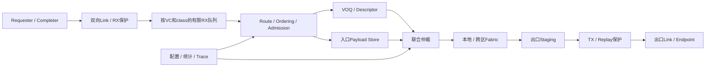

# PCIe 6.0 Switch 架构设计

版本：v1.1｜日期：2026-11-17｜状态：待实现的架构，不含性能验证结论。
依据[需求v1.0](PCIe6_Switch_Requirements.md)；软件执行合同见
[仿真架构](PCIe6_Simulation_Architecture.md)，交付顺序见
[实施计划](PCIe6_Implementation_Plan.md)。

## 1. 决策与适用范围

TDD仅规定开发方法：为下述模块和功能先定义验证场景与退出标准，再实现
并回归。gem5 Switch架构、资源所有权及实施计划M0–M5保持不变；不采用
函数→SystemC→RTL降低路线。测试合同见
[验证场景](PCIe6_Validation_Scenarios.md)。

PCIe Base Specification 6.0决定协议行为，HTML实验台决定功能、输入和
输出，DWC databook补充controller实现边界；竞品资料提供候选规格。
采用参数化端口、入口持有payload、稀疏VOQ、出口授权拉取和有限Fabric。
首版为单透明域、synthetic端点、MemRd/MemWr/CplD、store-and-forward。

| 维度 | 选择 | 对架构的影响 |
|---|---|---|
| 执行模式 | `lab_reference` / `pcie6_timing` | 参考公式和事件近似与有限资源模型分开 |
| link精度 | TLP服务预算 / 详细FLIT | packing、FC、replay覆盖分别声明 |
| controller接口 | transaction / 可选`controller_detail` | beat、TRGT1/XALI、DBI不阻塞首版 |
| 场景profile | HTML默认 / `competitor_target` / 用户配置 | 选择输入和目标，不改变协议规则 |
| 物理组织 | 未细化 / 可选slice-bank profile | HTML的并行Fabric通道不等于物理Slice |

TLP级模型即使逐跳反压正确，也不能宣称完整PCIe6合规。C/T、Atomic、
RO/IDO、混代、NTB、枚举、广播/INC、CXL按能力矩阵独立启用；未实现即
拒绝配置。PHY模拟电路、电气合规、PPA与RTL签核需外部证据。

## 2. 基础数据路径

每条Link两个方向独立；Read请求与返回CplD分别消耗资源。每次转发只
按一次payload计交换吞吐，输入/输出/wire/Fabric计数各自保留。
RX队列与core store均有限，前者保护外链接收，后者隔离出口竞争。
出口取得受保护副本后，入口引用才能释放。

### 2.1 模块合同

本表是模块索引；具体内部状态、存储、ordering关系、信用映射、原子
仲裁和前进性policy见§11。软件对象、消息API及周期执行见仿真架构§14。

| 模块 | 状态/配置 | 释放或提交条件 |
|---|---|---|
| Requester | Function/Tag表、DMA队列、Cpl预算 | 最后合法CplD或明确失败后释放Tag；回调一次 |
| Completer | 有限服务队列、MPS/RCB、服务率 | 生成合法Cpl片段并提交反向路径 |
| Link/RX | 方向服务、RX backing、FC、接收进度 | 对应存储可重新承诺后发FC更新 |
| Route/Order | 地址域、bus范围、属性、ordering域 | 仅合法目标及eligible事务进入仲裁 |
| Admission/Store | sector、descriptor、共享配额 | 原子分配；引用为零且副本受保护后归还 |
| VOQ | 出口/VC/class/ordering-domain索引 | grant后移交服务，不丢失顺序约束 |
| Scheduler/Fabric | RR状态、bank/slot/出口资格 | 联合grant完成，不留下部分长期锁定 |
| Egress/TX | staging、可连续发送数据、replay | 数据移交保护副本；replay待确认释放 |
| Metrics | 字节、时间戳、stall、峰值 | 绑定配置hash与实际测量窗口 |

透明转发不建立所有端点的全局Requester表；transit Tag保持不变。
`trackMode=transparent`仅可选监控，`proxy`才建立本地发起/重组状态。
本地Cpl容量与Tag预算独立，不能因Tag空闲就无限发起Read。

## 3. 协议与服务边界

以需求§3的Base Spec条款矩阵为协议入口，逐项声明实现/近似/未支持。
请求按MPS/MRRS及4KiB边界拆分，Completion遵循端点角色对应的RCB、
Byte Count、Lower Address、长度与状态规则。Requester ID/Tag、TC/VC、
顺序属性和适用reserved字段保留；合法RO/IDO以外不允许任意重排。

透明模式只接受合法层次与地址/ID路由。mesh/ring/Clos可作graph探索，
不能因连通就宣称PCIe透明拓扑可部署；NTB和专用Fabric另定义地址与
顺序合同。首版路由初始化后固定，动态更新须排空或使用明确epoch。

详细FLIT使用256B布局，236B TLP区仍含事务头部与填充，不等于应用效率。
FLIT Mode TX须支持Shared FC，RX支持可选；能力、协商和启用状态分别保存。
重传复用TLP信息并更新DLP，不重复扣新事务信用或向端点重复交付。
低速FLIT编码与non-FLIT是独立profile，不能只改变带宽数值。

`lab_reference`保留HTML的可调头部、packing系数、RCB/Tag预算假设、
定时信用回收与replay限速；这些近似不能进入严格协议覆盖的证据。
详细模式修正HTML差异时，报告原始输入、规则、有效值及结果影响。

## 4. 三个资源账本与调度

| 账本 | 所有者 | 关键不变量 |
|---|---|---|
| 外链dedicated/shared FC与RX backing | 接收端port | 承诺空间覆盖已接收、在途及可继续发送的信用 |
| core sectors/descriptors/VOQ/Fabric slots | switch core | 已用+预留+空闲=总容量；无双释放 |
| staging/replay | 出口port/core | 未确认数据始终有受保护副本；无越界覆盖 |

RX到core的grant先预留空间，交付时将预留转为占用；不能再次扣减。
RX出队后可回收其信用，core引用释放是另一事件。FC更新计控制与传播
延迟，实际资源未释放时不因计时器到期返还信用。

出口选择eligible队头，并联合检查bank读、Fabric slot、staging空间。
无法满足则保持队列状态；同Slice本地路径也消耗对应服务。初始使用RR，
记录age和饥饿；P/NP/Cpl保留资源与channel依赖图共同检查前进性。
无故障停止注入后必须排空。普通拥塞不drop/trim。

store-and-forward作为默认。C/T另定义头部可用、已验证范围、尾部abort、
下游保护与提交条件；不能用提前释放未校验payload换取90ns结果。

## 5. HTML参数到硬件资源

全部63项输入、默认值、范围和自动规则继承需求§5，不在架构重复维护。

| 输入组 | 架构映射 | 必须保留的区别 |
|---|---|---|
| `op/payload/offset/mps/mrrs/rcb/cplSplit` | 端点分段/重组 | 应用传输、单请求、CplD、Cell |
| `reqPorts/cplPorts/switches/*Lanes` | 端口与链路拓扑 | 发起/响应方向与切割share |
| `rate/*Meters/retimers/*Ns/rttMode` | Link与端点时延 | 输入RTT预算和实际RTT，禁止重复叠加 |
| `functions/tagBits/tagBudget/requestLimit/cplLimit` | 身份与服务窗口 | 每Function Tag、聚合速率与实际能力 |
| `clock/util/channels/portWidth` | 每方向内部服务 | 预算利用率与显式气泡避免双扣 |
| `slices/fabricWidth/fabricCreditNs` | 并行Fabric通道/slots | 并行通道与物理Forwarding Slice |
| `vc/headerCredits/dataCredits/replayFlits` | 外链窗口及replay | 参考H/D建议不直接等于Shared FC配置 |
| `cell/meta/poolKiB/activeVoq/voqDepth/descriptor` | core缓存预算 | 每入口payload、每芯片descriptor和附加开销 |
| `egressCells/burst/burstNs/simUs/simArrival` | staging与实验负载 | 分析突发、实际注入、观察窗口 |

0=自动时先输出HTML建议值，再检查严格profile所需的backing；显式容量
不能静默扩大。`sramFactor`仅为ECC/对齐预算，不增加可用payload容量。
不同资源不足时报告具体stall及限制项，不能统称带宽不足。

## 6. 基线与物理容量探索

HTML默认144 lanes、9端口、每入口128KiB、9条并行Fabric通道；这不是
3个物理Slice/总3MiB的声明。默认接口宽度与窗口按页面公式推导。

可选profile扫描64/104/144 lanes、总payload 1/3/6MiB、16/32/64B
sector、bank数/服务宽度/端口数和时钟。此前3×48-lane物理Slice、每Slice
1MiB、16×64KiB、512-bit 1R1W@1GHz、每方向512GB/s保留为探索点。
启用物理profile时显式分配每入口额度，容量和端口映射须能核算。

RX header/data、descriptor、core payload、staging、replay、可选服务
存储分别计容；metadata/sector rounding、bank冲突及读写服务分别计费。
这些扫描只能筛选候选，不输出无来源SRAM宏、面积、功耗或无阻塞结论。

## 7. 竞品补充目标的架构映射

`competitor_target`是场景层，须另选执行模式/精度。所有目标来自需求
§11，保存来源、假设、测量合同及相对HTML默认配置的差异。

| 补充目标 | 对应模块/实验 | 当前边界 |
|---|---|---|
| COMP-01/03/15 | port预算、MPS、级联/radix扫描 | 预算合法不等于PHY分叉已验证 |
| COMP-04/05 | C/T、core/link/endpoint时延分解 | 90ns、100ns、250ns不同测点，不写成已达到 |
| COMP-06/07/08 | 大包、64B、置换、70%负载尾延 | 独立协议上限；稳态与热点分列 |
| COMP-02 | 多域/NTB/窗口/门铃 | 另建端点翻译和隔离后启用 |
| COMP-09 | 分支descriptor、共享payload引用 | 慢成员和复制带宽真实计费 |
| COMP-10/11 | INC上下文、数值、算力与累加器 | 未建服务前不输出加速收益 |
| COMP-12/13 | telemetry、故障与管理分域 | 未实现物理总线不能称I2C/MCTP支持 |
| COMP-14 | 独立CXL/Type-3/FM或PCIe KV路径 | PCIe6模型不推导CXL.mem支持 |
| COMP-16/17/18 | 外部对比/证据登记 | Gen5/Ethernet/待核实规格不混为PCIe6约束 |

## 8. Databook细化与系统扩展

F-23–F-32保持为补充合同。RADM对应RX过滤与队列，XADM对应TX形成/
仲裁，CXPL对应协议链路，CDM/DBI/ELBI对应配置与本地访问；基础模型可
采用等价事务抽象，不要求使用DWC专用接口名或RAM布局。

`controller_detail`增加TRGT1在途grant与提前class halt、XALI halt稳定/
连续供数及跨client ordering。XADM不提供普通TX FIFO，staging属于core。
配置扩展再区分USP本地CFG、DSP DBI代理、下游CFG转换和一次Completion。
PME聚合、INTx swizzle、hot reset/DPC和管理复位分别定义错误收束合同。

DWC v5.71a为Gen5参考，不能证明Gen6 FLIT/FC行为。当前工作区未发现
该补充PDF；接口细化需恢复可访问版本并核对页码，基础阶段不受其阻塞。

## 9. 架构验收

基础验收覆盖F-01–F-09、F-17–F-22及S-01–S-08；模式适用范围分别声明。
协议按条款，参考按HTML，竞品按目标profile独立报告，不共用“通过”标记。

[实施计划](PCIe6_Implementation_Plan.md)是阶段、依赖与完成证据的唯一
排期来源。资源守恒、有限反压、数据正确性和排空先于性能对比；完整协议
签核、PHY/PPA和未实现扩展不因文档验收而自动完成。

## 10. SimAI作为周期模型上层工作负载

本节实现需求§12的SIM-01–SIM-16，M3周期门与M4闭环分别验收。

gem5周期级端口/bank/仲裁/Fabric/Link及Completion模型先通过M3验收，
再由M4接入SimAI/SimCCL。上层只生成带依赖的flow，经同一DMA/TLP入口
驱动本架构；不得在SimAI另写固定时延Switch或复制一套credit/replay。

AstraNetworkAPI适配、消息匹配、共同事件时间和callback合同见仿真架构
§11。微基准与workload共用硬件资源路径，归约默认发生端点，PCIe-only
不自动启用NVLS/INC。M4的因果闭环检查要求拥塞真实延迟后继任务，
不是把gem5吞吐标量导入SimAI就称完成集成。

## 11. Switch微架构详细设计

本节是M2/M3实现选择，不是已实现IP能力。原§1–10的范围与M0–M5顺序
不变。基本模式为S/F、固定路由、有限存储和RR；所有新增结构参数均写入
effective ResourceProfile，不能隐藏在HTML的`util`或固定switchNs中。

### 11.1 物理端口、逻辑端口和Slice组织

一个逻辑PCIe port具有独立Link、TC/VC映射、RX backing、TX/replay和
upstream/downstream角色。Port Macro只是lane/PHY分组，不代替逻辑端口。
`PortBinding`记录(port_id, link_id, peer_port_id, role, width, rate,
partition, forwarding_slice)。同一lane不能重复分配；实际PHY分叉合法性
来自独立profile，不由总lane数推导。

每个Forwarding Slice拥有本地sector pool、bank映射、descriptor池、
VOQ表、输入写服务与Fabric接入；芯片级Scheduler协调出口和跨区服务。
M2无物理分区时可视为单个逻辑Slice，仍按每入口配额和有限资源记账。
M3将port显式映射到Slice，分别限制本地路径和跨Slice路径的服务能力。
HTML `slices`始终表示Fabric并行通道数，不自动创建物理Slice。

### 11.2 RX front end：接收、分类和admission

每port的`RxContext`包含：VC/class的header槽、data单元、接收中事务、
待core队列、FC承诺、解析服务可用周期。header/metadata与payload分账。
MemRd无payload仍需header/descriptor/解析服务，不占假想payload sector。

接收分为LINK_RECEIVING、VALIDATED、WAIT_CORE、CORE_COMMITTED和
RELEASED。S/F只有完整有效TLP才进入VALIDATED；错误先由所选链路/事务
profile决定重试或错误处理，再释放其拥有的资源，不向core交付坏payload。

`FrontEnd`每周期同时受`parse_bytes_per_cycle`和`tlps_per_cycle`限制。
它产生不可变的ParsedHeader、payload handle、目标候选和ordering序号。
route miss、能力不支持与资源不足是不同结果，资源不足只能等待。

Admission的一次原子bundle为：descriptor槽、所需payload sectors、
VOQ现有/新建索引槽、入口及class配额。先计算需求再检查全部预算，
成功后一次commit；失败不扣任何预算，保留RX所有权并登记等待资源。
core保护建立之前不能返还代表该RX空间的信用。

Admission资源commit与数据写完是两个事件：先进入WRITE_PENDING，core
sector/descriptor已占用，但RX仍持有效源副本；按bank写服务推进copy。
最后写入完成后标记payload DATA_READY、将descriptor加入可仲裁集合，再
释放RX源引用并触发其信用回收。队列可预建占位，但DATA_READY前不可grant。
header-only请求没有payload写服务，仍需遵守metadata/前端pipeline完成点。

因此写入期间RX与core同时占空间是有意的物理双副本，而非重复应用字节。
写入失败时已commit的core分配经明确失败retire释放，不能调用未commit
的cancel；RX错误消费/重试和信用处理由所属协议层决定，不提前当成功。

### 11.3 Route Engine与地址域

初始化编译RouteTable：partition、地址base/limit、出口、目标端点、
bus范围、方向与权限；初版禁止重叠或歧义窗口。请求走地址查询，Cpl按
Requester ID/bus归属查询，不能用Cpl payload地址作返回路由。

普通透明树中：下行来包优先检查合法peer/downstream窗口，再检查上行
路径；上行来包须命中合法下行目标，否则走对应错误路径。路由不得把
TLP送回来源端口形成环。返回path与请求path独立计算并可trace验证。

M0拓扑只做结构检查；M2构造真实port/link/window图，并验证每条实验
flow的可达路径和lane/port预算。动态窗口变化在M5处理，需停止新准入并
排空或使用显式route epoch，不改写在途descriptor的目的解释。

### 11.4 Order Engine：依赖而不是全局FIFO

默认RO=0、IDO=0、同TC内比较；不同TC不人为增加协议ordering边。
每个入口/partition/TC维护接收序号，descriptor另保存Requester ID、Tag、
出口及方向。Requester/Tag用于同请求Cpl排序，不能把不同Requester一律
视为互不相关而漏掉P与后续事务的关系。

M2基线采用显式标记的保守入口顺序域：同入口、partition、TC内按规范
关系建立依赖；必要的跨源归并由输入链路与选定路由策略定义。保守域
可能阻塞不同出口的可选越过，须报告该限制；优化域必须另给条款/场景
证明，不把额外串行化结果宣传为non-blocking能力。

| 后到事务 / 早到事务 | P：MemWr | NP：MemRd | CplD |
|---|---|---|---|
| P：MemWr | 等早P提交 | 必须能绕过阻塞NP | 可越过，按明确策略 |
| NP：MemRd | 等早P提交 | 可越过，基线class内FIFO | 可越过，按明确策略 |
| CplD | 等早P提交 | 必须能绕过阻塞NP | 同Request ID保持地址顺序；不同请求可选 |

该表是Base Spec §2.4.1/Table 2-42（印刷页222–224）在所选普通内存
事务子集的实现索引，不覆盖RO/IDO、带数据NP、IDE和其他例外。
“提交”在M2保守模型指早TLP最后字节进入该出口Link发送服务，不代表
远端内存已经可见。优化为更早提交点前必须证明不会改变同出口发送顺序。

`isEligible(desc)`检查其禁止越过的前驱是否已提交；P/Cpl绕过NP不能因
共享单FIFO或一个阻塞head失效。至少分P/NP/Cpl队头，Cpl内保留同Tag
片段顺序。采用每class未退休序号集合与依赖计数，相关前驱退休后唤醒；
不在每次仲裁遍历历史全部事务。关系变更必须有V-10反例和前进性trace。

### 11.5 Payload Store、descriptor与VOQ数据结构

Payload Store存TLP有效payload；完整header保存在descriptor。sector需求
为`ceil(payload_bytes / sector_bytes)`；内部Fabric则按所选header+payload
cell化合同收费，不能将这两个rounding混成同一容量。0B payload需要0个
payload sector，但仍需要metadata、VOQ和传输服务。

`StoreHandle`为(pool_id, object_id, generation, sector_chain, valid_bytes)。
allocator维护free-list及used/reserved/free，按入口和class执行保底/共享
配额。generation用于检测过期句柄；复用object ID不接受旧release。
M3可用`bank=(sector_index mod bank_count)`作为初始可重放映射；其他hash
作为profile选择记录，不使用宿主语言不稳定hash。

`ForwardDescriptor`含header、store handle、ingress/egress、VC/class/TC、
ordering domain/sequence、timestamps、route epoch和当前owner。
VOQ key为(ingress, egress, VC, class, ordering_domain)，payload不复制。
每入口维护active-key表与每出口active-head列表；空队列回收前确认没有
在途grant引用，descriptor独立从全局/局部池归还。

HTML `voqDepth`是Cell额度，`descriptor`是参考预算字节；实际descriptor
数量、队列索引数、Cell配额分别限制。不能把每Cell一个descriptor的参考
预算直接当成每TLP实现布局；结果同时输出参考预算与实际对象数。

### 11.6 Scheduler：确定性两步联合仲裁

每出口维护RR游标，输入候选来自active heads，先过滤ordering，再过滤
出口可接收条件。以稳定出口轮转顺序构建grant；同周期多出口竞争同一
bank、Fabric通道或入口读端口时使用同一轮shadow资源快照消除冲突。

一次首Cell grant联合预留：完整TLP的出口staging配额、一个可服务bank
读slot、Fabric/本地路径slot和有限in-flight transfer记录。检查全部可用
之后在一个线性化点commit，随后才移除VOQ head、转移descriptor owner
并推进RR。检查失败不推进游标、不持有部分token、不消耗服务slot。

多Cell TLP进入ACTIVE_TRANSFER，staging保留其完整空间；后续Cell逐次
获取bank/Fabric服务，不提前锁定未来所有周期。continuation参加显式
公平仲裁，不能无限饿死新包；每次服务有实际字节和结束事件。失败时
in-flight descriptor保留已有进度，不重复取走VOQ或重复分配staging。

M2先按aggregate Fabric服务预算执行同一生命周期；M3再增加bank/
parallel channel/cell服务。两种精度不改变容量和所有权，只改变服务完成
时刻。真实下游Link credit不一定在首grant就可用，staging允许有限解耦；
credit耗尽最终填满staging并逐级反压，而不是整个core无条件停转。

### 11.7 SRAM、Fabric与CDC服务

每bank独立声明读/写端口数、beat宽度、读延迟和周期。1R1W可同周期一
读一写，不是任意两个读；单端口profile的读写互斥。大sector需多beat时
按实际beat占用服务，不能只增加一个固定延迟但不扣带宽。

Fabric区分本地与跨区通道、Cell数据/metadata、服务宽度、频率、pipeline
和slot数。读取完成→Fabric进入→出口接受分别有事件；一条通道可pipeline
接收但在途slot有限，吞吐/延迟/容量不能用一个free_tick混合表示。
跨时钟用有界队列与目标时钟取整后的服务事件，记录CDC延迟；这只是
仿真抽象，不声明实现了可签核的硬件CDC电路。

bank/Fabric的每个slot都有开始/结束与token ID，完成事件释放对应token。
源payload在最后Cell受staging保护后才减少入口引用，不能在首Cell读完
时归还整包存储。完整staging建立前不在S/F模式发送不完整TLP。

### 11.8 Egress、Link TX与replay

Egress按VC/class有有限重组/待发送状态，保留header、有效字节、到齐范围
与发送序。WAIT_DATA→READY→TX_ACCEPTED→RETIRED；重复Cell或缺口
产生明确错误，不用未初始化字节填补。完整READY包仍需通过TX ordering。

TX同时受端口服务、link串行化、FC gate和replay保护约束。port内部服务
与wire服务可串接或重叠，profile写明pipeline，不能简单相加两份包含同一
传输的数据延迟。Link每方向next_available独立，不把双向raw当单向容量。

replay持有可重构TLP信息/必要序号，ACK后才释放。详细FLIT重新生成DLP，
重传占wire但不新扣事务信用、不重复交付应用。无错TLP预算profile可用
显式近似ACK服务，但不能因此宣称NAK/timeout/窗口序号协议已实现。
Link reset后旧ACK/Cpl不得释放新generation对象；错误恢复另按profile
处理，不把局部reset无条件映射为远端Request成功。

### 11.9 外链信用到接收存储的映射

CreditManager分离逻辑FC单位与物理backing。data基本单位为16B；header
unit须能容纳所选端口/能力的最大header/trailer，不等于HTML的reqHeader。
基础MemRd消耗NP header，MemWr消耗P header/data，CplD消耗Cpl header/
data，具体cost由协议policy返回，不在多个模块各算一遍。

| 状态 | 维护内容 | 更新点 |
|---|---|---|
| RX backing | 各dedicated/shared池的总量、占用及仍可被信用消费的承诺 | 初始化/接收/出队/更新准备 |
| TX FC | cumulative limit/consumed、field width、scale、pool/VC usage | 收到FC更新/通过send gate |
| RX update | freed但未通告量、已经排队的更新、in-flight更新 | 出队累加，阈值或最大update延迟触发 |
| Group packing | Shared FC所用credit group及未使用余量 | 新group/后续TLP复用/满足释放粒度 |

M3按Base Spec §2.6.1（页236–242）实现Shared FC的group消费/释放：
未merged的适用class按4-credit group，允许P/Cpl merged时按其8-credit
合同处理；同group余量和计数用途不可丢弃。Table 2-45的基础单位计费
不等于每个FLIT TLP都独立扣1H及ceil(payload/16)D。

初始化通告值要有真实backing且满足规范最小值；RX release产生pending
更新，控制发送服务与传播后更新TX limit。阈值/最大延迟是可配置实现
策略，不允许无限拖延造成永久停顿。模计数采用字段位宽、scale及规范
gate比较，必须有wrap边界fixture；不能用宿主整数直接减模字段后判断负数。

dedicated与shared、启用与能力、P/Cpl merged分别保存。RX可不启用
Shared FC，但FLIT TX必须声明相应能力；Merged FC未实现时明确拒绝。
core释放不直接改TX邻居credit，只有相应RX backing释放事件可驱动更新。

### 11.10 前进性资源与故障收束

基础profile禁止把全部RX/core/descriptor空间配置为NP可独占共享池。
每启用VC/class的dedicated资源至少满足该profile规范最小通告和最大
单事务接收要求；内部P/Cpl各保留独立header/descriptor及最大所支持
payload的可前进空间。NP MemRd保留header但不虚构data保留需求。

共享准入不得消耗其他class保底；P与Cpl所需出口/staging服务也必须有
合法获得机会。Link控制更新/ACK使用有限独立控制队列与服务机会，不
依赖先发出被其阻塞的数据。此处保底是架构policy，不是死锁证明。

启动时构建class/queue/bank/staging/replay/endpoint依赖图，检查profile
和树路由的等待环；运行时记录wait-for对象和年龄。必须能让P/Cpl绕过
阻塞NP，Read不能在持住其返回必需的所有Cpl空间时继续无限发起。
排空证明只针对有限注入、sink/ACK/FC阻塞有界、仲裁持续服务的场景；
失联端点由超时/失败合同收束，不能归为可正常完成的排空。

### 11.11 管理、错误与统计边界

配置分结构错误、协议能力缺失、路由/权限错误和运行时协议错误；资源
暂满是Blocked而不是Error。错误记录带port/descriptor/request/epoch和
首个失败原因。诊断保留首错，避免后续清理错误覆盖原始原因。

Stats按应用payload、TLP、FLIT/wire、Fabric Cell分别累计，输出每周期
解析/读写/grant/发送服务和各资源占用；peak在预留/提交/释放定义好的
观察点采样。一次阻塞episode记录起止和原因，不能每次重试都算一个新
stall事件；持续时间与次数分别报告，复合原因提供主因及secondary mask。

trace可按flow/request/port/时间窗过滤，但关闭trace不能改变调度顺序。
warmup/measurement/drain对arrival cohort、completed bytes和删失样本
定义一致；过载/样本不足不能用无条件P99/P999判断掩盖。

### 11.12 模块完成条件

M2退出要求端点、RX/Core/VOQ/Scheduler/Fabric/Egress/Link在容量和
回调合同下组合正确；M3增加周期bank/FLIT/FC/replay及选定错误覆盖。
V-03–V-18/21–V-25/35分别绑定上述模块，具体映射见实施计划的设计索引。
模块测试先于实现，TDD不替代本节的结构、算法和通信设计。
