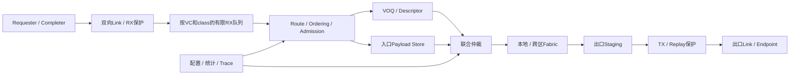

# PCIe 6.0 Switch 架构设计

版本：v1.0｜日期：2026-11-17｜状态：待实现的架构，不含性能验证结论。
依据[需求v1.0](PCIe6_Switch_Requirements.md)；软件执行合同见
[仿真架构](PCIe6_Simulation_Architecture.md)，交付顺序见
[实施计划](PCIe6_Implementation_Plan.md)。

## 1. 决策与适用范围

TDD仅规定开发方法：为下述模块和功能先定义验证场景与退出标准，再实现
并回归。gem5 Switch架构、资源所有权及实施计划M0–M5保持不变；不采用
函数→SystemC→RTL降低路线。测试合同见
[验证场景](PCIe6_Validation_Scenarios.md)。

PCIe Base Specification 6.0决定协议行为，HTML实验台决定功能、输入和
输出，DWC databook补充controller实现边界；竞品资料提供候选规格。
采用参数化端口、入口持有payload、稀疏VOQ、出口授权拉取和有限Fabric。
首版为单透明域、synthetic端点、MemRd/MemWr/CplD、store-and-forward。

| 维度 | 选择 | 对架构的影响 |
|---|---|---|
| 执行模式 | `lab_reference` / `pcie6_timing` | 参考公式和事件近似与有限资源模型分开 |
| link精度 | TLP服务预算 / 详细FLIT | packing、FC、replay覆盖分别声明 |
| controller接口 | transaction / 可选`controller_detail` | beat、TRGT1/XALI、DBI不阻塞首版 |
| 场景profile | HTML默认 / `competitor_target` / 用户配置 | 选择输入和目标，不改变协议规则 |
| 物理组织 | 未细化 / 可选slice-bank profile | HTML的并行Fabric通道不等于物理Slice |

TLP级模型即使逐跳反压正确，也不能宣称完整PCIe6合规。C/T、Atomic、
RO/IDO、混代、NTB、枚举、广播/INC、CXL按能力矩阵独立启用；未实现即
拒绝配置。PHY模拟电路、电气合规、PPA与RTL签核需外部证据。

## 2. 基础数据路径

每条Link两个方向独立；Read请求与返回CplD分别消耗资源。每次转发只
按一次payload计交换吞吐，输入/输出/wire/Fabric计数各自保留。
RX队列与core store均有限，前者保护外链接收，后者隔离出口竞争。
出口取得受保护副本后，入口引用才能释放。

### 2.1 模块合同

| 模块 | 状态/配置 | 释放或提交条件 |
|---|---|---|
| Requester | Function/Tag表、DMA队列、Cpl预算 | 最后合法CplD或明确失败后释放Tag；回调一次 |
| Completer | 有限服务队列、MPS/RCB、服务率 | 生成合法Cpl片段并提交反向路径 |
| Link/RX | 方向服务、RX backing、FC、接收进度 | 对应存储可重新承诺后发FC更新 |
| Route/Order | 地址域、bus范围、属性、ordering域 | 仅合法目标及eligible事务进入仲裁 |
| Admission/Store | sector、descriptor、共享配额 | 原子分配；引用为零且副本受保护后归还 |
| VOQ | 出口/VC/class/ordering-domain索引 | grant后移交服务，不丢失顺序约束 |
| Scheduler/Fabric | RR状态、bank/slot/出口资格 | 联合grant完成，不留下部分长期锁定 |
| Egress/TX | staging、可连续发送数据、replay | 数据移交保护副本；replay待确认释放 |
| Metrics | 字节、时间戳、stall、峰值 | 绑定配置hash与实际测量窗口 |

透明转发不建立所有端点的全局Requester表；transit Tag保持不变。
`trackMode=transparent`仅可选监控，`proxy`才建立本地发起/重组状态。
本地Cpl容量与Tag预算独立，不能因Tag空闲就无限发起Read。

## 3. 协议与服务边界

以需求§3的Base Spec条款矩阵为协议入口，逐项声明实现/近似/未支持。
请求按MPS/MRRS及4KiB边界拆分，Completion遵循端点角色对应的RCB、
Byte Count、Lower Address、长度与状态规则。Requester ID/Tag、TC/VC、
顺序属性和适用reserved字段保留；合法RO/IDO以外不允许任意重排。

透明模式只接受合法层次与地址/ID路由。mesh/ring/Clos可作graph探索，
不能因连通就宣称PCIe透明拓扑可部署；NTB和专用Fabric另定义地址与
顺序合同。首版路由初始化后固定，动态更新须排空或使用明确epoch。

详细FLIT使用256B布局，236B TLP区仍含事务头部与填充，不等于应用效率。
FLIT Mode TX须支持Shared FC，RX支持可选；能力、协商和启用状态分别保存。
重传复用TLP信息并更新DLP，不重复扣新事务信用或向端点重复交付。
低速FLIT编码与non-FLIT是独立profile，不能只改变带宽数值。

`lab_reference`保留HTML的可调头部、packing系数、RCB/Tag预算假设、
定时信用回收与replay限速；这些近似不能进入严格协议覆盖的证据。
详细模式修正HTML差异时，报告原始输入、规则、有效值及结果影响。

## 4. 三个资源账本与调度

| 账本 | 所有者 | 关键不变量 |
|---|---|---|
| 外链dedicated/shared FC与RX backing | 接收端port | 承诺空间覆盖已接收、在途及可继续发送的信用 |
| core sectors/descriptors/VOQ/Fabric slots | switch core | 已用+预留+空闲=总容量；无双释放 |
| staging/replay | 出口port/core | 未确认数据始终有受保护副本；无越界覆盖 |

RX到core的grant先预留空间，交付时将预留转为占用；不能再次扣减。
RX出队后可回收其信用，core引用释放是另一事件。FC更新计控制与传播
延迟，实际资源未释放时不因计时器到期返还信用。

出口选择eligible队头，并联合检查bank读、Fabric slot、staging空间。
无法满足则保持队列状态；同Slice本地路径也消耗对应服务。初始使用RR，
记录age和饥饿；P/NP/Cpl保留资源与channel依赖图共同检查前进性。
无故障停止注入后必须排空。普通拥塞不drop/trim。

store-and-forward作为默认。C/T另定义头部可用、已验证范围、尾部abort、
下游保护与提交条件；不能用提前释放未校验payload换取90ns结果。

## 5. HTML参数到硬件资源

全部63项输入、默认值、范围和自动规则继承需求§5，不在架构重复维护。

| 输入组 | 架构映射 | 必须保留的区别 |
|---|---|---|
| `op/payload/offset/mps/mrrs/rcb/cplSplit` | 端点分段/重组 | 应用传输、单请求、CplD、Cell |
| `reqPorts/cplPorts/switches/*Lanes` | 端口与链路拓扑 | 发起/响应方向与切割share |
| `rate/*Meters/retimers/*Ns/rttMode` | Link与端点时延 | 输入RTT预算和实际RTT，禁止重复叠加 |
| `functions/tagBits/tagBudget/requestLimit/cplLimit` | 身份与服务窗口 | 每Function Tag、聚合速率与实际能力 |
| `clock/util/channels/portWidth` | 每方向内部服务 | 预算利用率与显式气泡避免双扣 |
| `slices/fabricWidth/fabricCreditNs` | 并行Fabric通道/slots | 并行通道与物理Forwarding Slice |
| `vc/headerCredits/dataCredits/replayFlits` | 外链窗口及replay | 参考H/D建议不直接等于Shared FC配置 |
| `cell/meta/poolKiB/activeVoq/voqDepth/descriptor` | core缓存预算 | 每入口payload、每芯片descriptor和附加开销 |
| `egressCells/burst/burstNs/simUs/simArrival` | staging与实验负载 | 分析突发、实际注入、观察窗口 |

0=自动时先输出HTML建议值，再检查严格profile所需的backing；显式容量
不能静默扩大。`sramFactor`仅为ECC/对齐预算，不增加可用payload容量。
不同资源不足时报告具体stall及限制项，不能统称带宽不足。

## 6. 基线与物理容量探索

HTML默认144 lanes、9端口、每入口128KiB、9条并行Fabric通道；这不是
3个物理Slice/总3MiB的声明。默认接口宽度与窗口按页面公式推导。

可选profile扫描64/104/144 lanes、总payload 1/3/6MiB、16/32/64B
sector、bank数/服务宽度/端口数和时钟。此前3×48-lane物理Slice、每Slice
1MiB、16×64KiB、512-bit 1R1W@1GHz、每方向512GB/s保留为探索点。
启用物理profile时显式分配每入口额度，容量和端口映射须能核算。

RX header/data、descriptor、core payload、staging、replay、可选服务
存储分别计容；metadata/sector rounding、bank冲突及读写服务分别计费。
这些扫描只能筛选候选，不输出无来源SRAM宏、面积、功耗或无阻塞结论。

## 7. 竞品补充目标的架构映射

`competitor_target`是场景层，须另选执行模式/精度。所有目标来自需求
§11，保存来源、假设、测量合同及相对HTML默认配置的差异。

| 补充目标 | 对应模块/实验 | 当前边界 |
|---|---|---|
| COMP-01/03/15 | port预算、MPS、级联/radix扫描 | 预算合法不等于PHY分叉已验证 |
| COMP-04/05 | C/T、core/link/endpoint时延分解 | 90ns、100ns、250ns不同测点，不写成已达到 |
| COMP-06/07/08 | 大包、64B、置换、70%负载尾延 | 独立协议上限；稳态与热点分列 |
| COMP-02 | 多域/NTB/窗口/门铃 | 另建端点翻译和隔离后启用 |
| COMP-09 | 分支descriptor、共享payload引用 | 慢成员和复制带宽真实计费 |
| COMP-10/11 | INC上下文、数值、算力与累加器 | 未建服务前不输出加速收益 |
| COMP-12/13 | telemetry、故障与管理分域 | 未实现物理总线不能称I2C/MCTP支持 |
| COMP-14 | 独立CXL/Type-3/FM或PCIe KV路径 | PCIe6模型不推导CXL.mem支持 |
| COMP-16/17/18 | 外部对比/证据登记 | Gen5/Ethernet/待核实规格不混为PCIe6约束 |

## 8. Databook细化与系统扩展

F-23–F-32保持为补充合同。RADM对应RX过滤与队列，XADM对应TX形成/
仲裁，CXPL对应协议链路，CDM/DBI/ELBI对应配置与本地访问；基础模型可
采用等价事务抽象，不要求使用DWC专用接口名或RAM布局。

`controller_detail`增加TRGT1在途grant与提前class halt、XALI halt稳定/
连续供数及跨client ordering。XADM不提供普通TX FIFO，staging属于core。
配置扩展再区分USP本地CFG、DSP DBI代理、下游CFG转换和一次Completion。
PME聚合、INTx swizzle、hot reset/DPC和管理复位分别定义错误收束合同。

DWC v5.71a为Gen5参考，不能证明Gen6 FLIT/FC行为。当前工作区未发现
该补充PDF；接口细化需恢复可访问版本并核对页码，基础阶段不受其阻塞。

## 9. 架构验收

基础验收覆盖F-01–F-09、F-17–F-22及S-01–S-08；模式适用范围分别声明。
协议按条款，参考按HTML，竞品按目标profile独立报告，不共用“通过”标记。

[实施计划](PCIe6_Implementation_Plan.md)是阶段、依赖与完成证据的唯一
排期来源。资源守恒、有限反压、数据正确性和排空先于性能对比；完整协议
签核、PHY/PPA和未实现扩展不因文档验收而自动完成。

## 10. SimAI作为周期模型上层工作负载

本节实现需求§12的SIM-01–SIM-16，M3周期门与M4闭环分别验收。

gem5周期级端口/bank/仲裁/Fabric/Link及Completion模型先通过M3验收，
再由M4接入SimAI/SimCCL。上层只生成带依赖的flow，经同一DMA/TLP入口
驱动本架构；不得在SimAI另写固定时延Switch或复制一套credit/replay。

AstraNetworkAPI适配、消息匹配、共同事件时间和callback合同见仿真架构
§11。微基准与workload共用硬件资源路径，归约默认发生端点，PCIe-only
不自动启用NVLS/INC。M4的因果闭环检查要求拥塞真实延迟后继任务，
不是把gem5吞吐标量导入SimAI就称完成集成。
