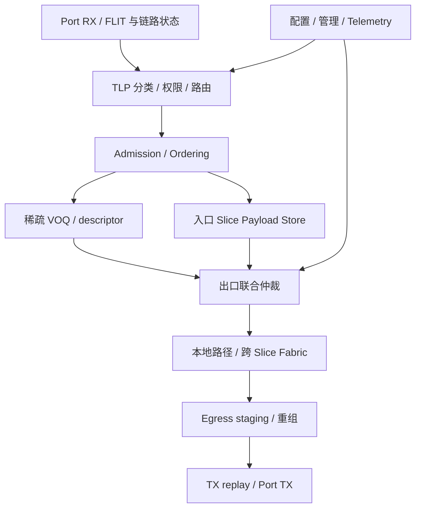

# PCIe 6.0 Switch 架构设计

状态：架构提案；容量和流水线是探索参数，尚无实现或实测结果。
本文定义硬件资源及其仿真映射；执行架构以
[gem5 仿真设计](PCIe6_Simulation_Architecture.md)为准，需求以
[需求定义](PCIe6_Switch_Requirements.md)中的 ID 为准。

## 1. 设计决策与边界

采用协议端口适配器、入口分布式 Payload Store、稀疏 VOQ、出口授权
拉取、分 Slice Fabric 和独立管理面。以标准 PCIe 单播 Read/Write 为
基础；广播与 INC 通过显式服务接口扩展，不改变普通事务的语义。

144 lanes、9 个 x16 等价 Port Macro、3 个 Forwarding Slice 是详细探索
基线，对应单 Host 八卡场景 SC-01。64/104 lanes 作为参数化容量点，
不能假定采用完全相同的物理组织。逻辑端口分叉同时受 PHY、PLL、复位
和 controller 数量限制，不能仅通过 lane 总数判定合法。

完整产品需求包含多 Host、NTB、RAS 等能力；首版仿真只验收单透明域。
未实现功能应在配置时拒绝，不能以零成本模型隐含支持。CXL.mem/cache、
UALink、Ethernet 需要独立协议适配器和合同，不属于本 PCIe 数据面。

## 2. 总体数据路径

入口拥有 payload；出口只在所需资源同时可用时授权拉取。同 Slice
事务走本地路径，跨 Slice 事务额外消耗 Fabric 服务。两者必须分别
统计时延、带宽和竞争，不能把“共享缓存”理解成无限带宽全局 SRAM。

默认完整 TLP 接收后再转发。后续 cut-through 需要独立的安全提交点、
剩余空间保证和错误收束机制；低时延目标不能通过跳过资源预留实现。

## 3. 模块与状态所有权

| 模块 | 持有状态 | 仿真中的可观测行为 |
|---|---|---|
| Port adapter | RX backing、FC、packing、TX replay | 串行化、信用停顿、ACK/retry |
| Transaction front end | 分类、域、路由与 ordering 属性 | TLP/cycle、解析和查表延迟 |
| Admission | sector/descriptor 配额、保留池 | 接收资格和资源不足原因 |
| Payload Store | sector、bank、有效字节、引用计数 | 碎片、bank 冲突、读写服务量 |
| VOQ / Order Engine | 出口/class/域队列和依赖 | HOL、eligible 队头、age |
| Scheduler | RR 状态和当轮联合 grant | 公平性、出口/bank/Fabric 竞争 |
| Fabric | 在途 cell 和有限 slots | 本地/跨区路径、元数据和占用 |
| Egress | staging、重组进度 | 出口降速和下游反压 |
| Management / RAS | 配置 epoch、计数、故障状态 | 配置一致性、排空和恢复 |

透明 Switch 不管理端点的全局 Read Tag 表；Requester 才拥有未完成
请求状态。Switch 自身作为服务端点发起请求时，另建本地 Requester。
内部 descriptor 保存 Requester ID、Tag 和目的路由，不能改写事务身份。

## 4. 协议与路由合同

每个端口适配器终止本地链路协议，向 core 提交已校验事务和有效 payload。
PCIe 外链 FLIT、内部 Fabric cell、SRAM sector 是三种不同对象。

Gen6 FLIT 格式和 shared FC 以所附 Base Specification 为依据，分别见
§4.2.3 和 §2.6.1。2020 年 DWC v5.71a databook 只用于理解 controller
与 switch core 边界，不作为 Gen6 FLIT、信用或重传规则的依据。

路由分为地址路由请求、Requester/ID 路由 Completion、配置路由三类；
首版只实现普通内存事务及其 Completion。Host 域、地址窗口和权限检查
先于资源提交；无路由、跨域和不支持事务走显式错误路径。

标准模式接受透明 PCIe 层次。NTB 必须定义地址转换、权限、门铃和独立
域状态；图形上连成 ring/mesh/Clos 并不代表标准 PCIe 路由合法。
配置更新先停止相关新事务，再排空或按明确 epoch 切换；不能让在途事务
混用新旧地址解释。首版可只允许初始化时配置。

VOQ 隔离目的拥塞，不授权任意重排。Order Engine 按已实现协议子集
产生 eligible 掩码，检查必要的允许越过与禁止越过关系。首版拒绝 RO/
IDO/Atomic 扩展；全局 FIFO 不能替代 ordering 和死锁分析。

## 5. 缓存、信用与释放

维护三个独立账本：外链 dedicated/shared FC；core sector/descriptor/
Fabric slots；出口 staging/replay。外链承诺的空间必须覆盖尚未抵达
的数据；内部资源不能直接当作外部 FC 计数。

Admission 原子预留 descriptor、payload sectors 和适用配额，失败不
留下部分占用。header-only 事务仍需要 descriptor、解析和队列服务。
短 payload 按 sector 向上取整，Fabric metadata 另计，不能只按有效字节
推导 SRAM/Fabric 吞吐。

出口授权同时检查 ordering、bank、Fabric、staging 及下游发送资格。
授权不持有会导致循环等待的部分资源；服务完成后释放本轮带宽槽位。
入口 payload 在数据完整移交至受保护存储且最后引用释放后归还。
Replay 副本在 ACK 前保留；replay 满会向入口传播反压。

RX 信用仅在对应 backing 可重新承诺后更新，并计入控制与传播延迟。
普通拥塞不丢包、不 trim、不按固定计时器无条件返还信用。

Completion、请求和管理的保留池大小为参数；建立资源依赖图检查循环。
验收包含停止注入后的排空和有界公平性。保留池或多 VC 本身不是死锁
证明。后续动态分区须保证不会撤销已承诺的接收容量。

## 6. 初始容量探索点

以下全部是 ARCH/SIM 参数，不能作为实现规格或 PPA 结论。

| 参数 | 起点 | 必须验证的限制 |
|---|---|---|
| 外部端口 | 9 × x16，144 lanes | 上下行组合、分叉和逻辑 controller 数 |
| Slice 映射 | 3 × 48 lanes | 本地与跨区置换、热点不均衡 |
| Payload SRAM | 总 3 MiB，每 Slice 1 MiB | 不含 RX、descriptor、replay 和服务存储 |
| bank | 每 Slice 16 × 64 KiB | 地址映射、sector packing 和冲突 |
| SRAM 服务 | 512 bit，1R1W，1 GHz / bank | 读写分别限制；ECC、macro 和仲裁待校准 |
| Fabric 服务 | 每 Slice 每方向 512 GB/s | cell/metadata 开销与实际拓扑割带宽 |
| sector | 扫描 16/32/64 B | 利用率、小事务吞吐、suballocation 冲突 |
| 仲裁 | eligible 队列间 RR | 饥饿、短包事务率和慢出口隔离 |

每 lane 8 GB/s 单向 raw，144 lanes 总计 1152 GB/s；每 Slice 为
384 GB/s。内部 512 GB/s 服务约为该 raw 数值的 1.333 倍，但不足以
单独证明无阻塞。每次转发的 payload 只计一次交换吞吐，TX/RX 统计分列。

扫描总 payload 1/3/6 MiB、不同 bank/sector/descriptor/Tag/credit/replay
深度；识别瓶颈转换，而不是只寻找单点最大吞吐。物理 Slice 数与并行
Fabric 通道数分别配置。端口 TLP/cycle 与 byte/cycle 都需建模。

Core <100 ns 与端到端 RTT <250 ns 保留为不同目标。测量必须声明
首/末 bit、入口/出口位置、包型、负载和同/跨 Slice；不将目标写为固定
延迟来“验证”目标。固定阶段、队列、串行化和端点服务分别计时。

## 7. 可选 AI Service Tile 与管理面

广播采用共享 payload、每分支 descriptor 和引用计数。慢成员影响原始
payload 生命周期；分支失败必须显式收束，不能提前释放或无限重试。
复制消耗实际 bank、Fabric、出口带宽和队列资源。

INC 使用显式服务地址/descriptor，包含 context、epoch、成员、dtype、
归约操作、数值顺序、累加器、超时和失败策略。普通 MemWr 不自动归约。
未实现数值正确性和有限服务能力前，不宣称 AllReduce 加速收益。

管理面导出路由、配额、资源高水位、ordering/credit/bank/replay stall、
协议错误及配置 epoch。复位先停止注入，再处理在途事务、引用和回调；
恢复不能留下孤立 Tag、credit 或 payload。热插拔、DPC 和多域恢复作为
后续独立测试合同，不用常量延迟替代协议行为。

## 8. 需求追踪与冻结条件

| 需求范围 | 架构响应 | 冻结证据 |
|---|---|---|
| F-01/02、SC-01 | 透明层次、P2P、Read/Write | 路由、数据、Completion 与配置测试 |
| F-06、A-03/04 | FC backing、有限缓存、VOQ | 守恒、反压、排空、ordering 测试 |
| A-01/02、P-05 至 P-08 | bank/Fabric/仲裁 | 置换、incast、hotspot、短包与尾延 |
| F-05/07/09 | 域、NTB、管理 | 后续显式权限与转换验证 |
| F-10 至 F-14 | 广播 / INC 服务 | 后续引用、数值与闭环 workload 验证 |
| T-03/04 | 校准和协议覆盖矩阵 | RTL/VIP/实测记录及误差范围 |

交付顺序和源码组织遵循仿真设计的 M0–M5。仿真可筛选容量和定位性能
瓶颈；PHY、SRAM macro、CDC、布局布线和协议签核仍需各自证据。
